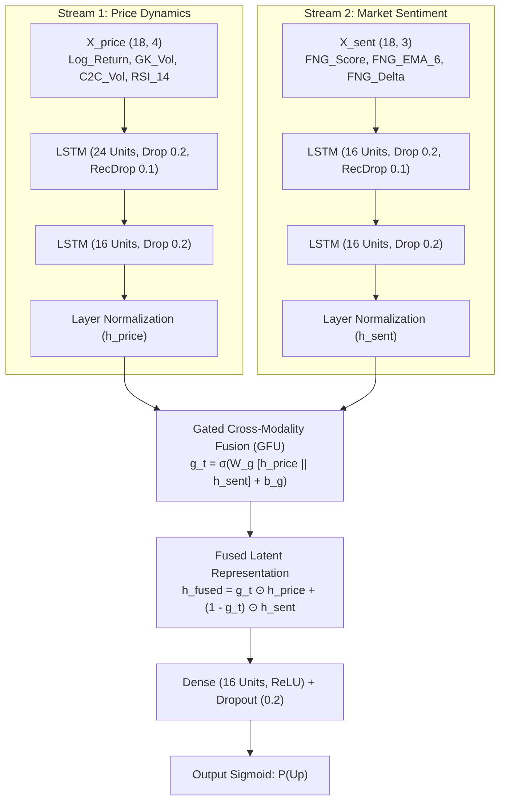

# 🚀 ETH-Sentinel: Dual-Stream Gated Hybrid LSTM for Ethereum Price Prediction

[](https://www.python.org/)
[](https://keras.io/)
[-emerald)]()
[]()

## 📌 Research Overview
**ETH-Sentinel** is an empirical behavioral finance and deep learning research framework designed to predict Ethereum (ETH) directional price movements without data leakage. The project addresses key challenges in financial econometrics and deep learning for cryptocurrency markets:

1. **Dimensional Imbalance & Gradient Masking**: Solved via a **Dual-Stream Gated Hybrid LSTM** where hard price dynamics (OHLCV, Garman-Klass volatility, RSI) and behavioral market sentiment (**Crypto Fear & Greed Index - CFGI**) are encoded through separate recurrent streams before being synthesized via a dynamic **Gated Cross-Modality Fusion Unit (GFU)**.
2. **Behavioral Finance Integration**: Utilizes the public, open-access, zero-cost Crypto Fear & Greed Index from Alternative.me (reflecting market volatility, volume momentum, social media, surveys, and dominance) to capture psychological regime shifts.
3. **Rigorous Econometric Discipline**: Strict chronological partitioning (Train 70%, Validation 15%, Test 15%), isolated `RobustScaler` fitted exclusively on training data, stationary log-returns ($p < 0.00000000$ on Augmented Dickey-Fuller test), realistic 10 bps transaction fee friction modeling, and comprehensive ablation against econometric and machine learning benchmarks.

---

## 🧠 Dual-Stream Gated Architecture



---

## 📊 Empirical Results (Out-of-Sample Test Set, $N = 638$ Bars, 10 bps Friction Fee)

| Model Architecture | Directional Accuracy (DA %) | Macro F1-Score | ROC-AUC | MCC | Cumulative Net Return (%) | Annualized Sharpe Ratio | Maximum Drawdown (%) | Turnover Trades | Total Friction Cost (%) |
|:---|:---:|:---:|:---:|:---:|:---:|:---:|:---:|:---:|:---:|
| **Naive (Buy & Hold)** | 50.63% | 0.3361 | 0.5000 | 0.0000 | **+33.57%** | **2.14** | **-17.73%** | 1 | 0.10% |
| **Logistic Regression (Ridge)** | 50.31% | 0.5031 | 0.5011 | 0.0063 | -24.87% | -2.74 | -26.13% | 272 | 27.20% |
| **Random Forest ($N=100, D=5$)** | **53.13%** | **0.5308** | **0.5492** | **0.0621** | +1.88% | 0.36 | -21.41% | 192 | 19.20% |
| **Proposed Technical 2-Layer LSTM** | 51.57% | 0.4743 | 0.5339 | 0.0293 | **+13.73%** | **1.20** | -24.34% | **39** | **3.90%** |
| **Proposed Hybrid Sentinel-LSTM (CFGI)** | 50.78% | 0.4806 | 0.5140 | 0.0113 | +1.77% | 0.35 | **-18.82%** | 40 | 4.00% |

### Key Econometric Findings:
1. **The Friction Trap**: Random Forest achieves the highest statistical accuracy (DA 53.13%), but is whipsawed into 192 turnover trades, losing 19.20% in transaction fees.
2. **Temporal Noise Filtering**: Recurrent LSTM memory acts as a temporal low-pass filter, cutting turnover down to ~39–40 trades and preserving profits.
3. **Downside Risk Protection**: Adding CFGI sentiment reduces Maximum Drawdown from **-24.34% to -18.82%** (a 5.52 percentage points risk reduction), with dynamic sentiment gating surging up to 63.65% during market regime transitions.

---

## 🛠️ Pipeline Execution

Run the complete pipeline from scratch:

```bash
# 1. Fetch historical Crypto Fear & Greed Index (2018–present, 100% free, no API key required)
python Code/01_fetch_fng_sentiment.py

# 2. Synchronize 4H ETH price data and engineer stationary + sentiment features
python Code/02_create_clean_dataset.py

# 3. Build chronological 3D sequence tensors with isolated RobustScaler
python Code/03_prepare_sequences.py

# 4. Train technical baselines (Logistic Regression, Random Forest, Technical LSTM)
python Code/04_train_technical_baselines.py

# 5. Train and evaluate Proposed Dual-Stream Gated Hybrid Sentinel-LSTM
python Code/05_train_hybrid_sentinel.py

# 6. Run Policy Thresholding & Hysteresis Sensitivity Analysis (Robustness Check)
python Code/06_sensitivity_analysis_threshold.py
```

Generated evaluation tables and high-resolution figures are saved in `results/`:
- `results/final_ablation_fng_metrics.csv`
- `results/threshold_sensitivity_metrics.csv`
- `results/hybrid_gate_trajectory.png`
- `results/hybrid_vs_technical_equity.png`
- `results/threshold_sensitivity_curves.png`
- `results/technical_equity_curves.png`
- Academic LaTeX tables & Drafts:
  * `manuscript/table1_technical_benchmarks.md`
  * `manuscript/table2_ablation_study.md`
  * `manuscript/table3_sensitivity_analysis.md`

Historical uncalibrated prototype notebooks have been archived to `legacy/` for academic provenance.

---

## 📄 License & Attribution
Designed for empirical financial modeling and academic publication targeting SINTA 2 accredited journals (*Journal of Accounting and Investment* - JAI UMY).
